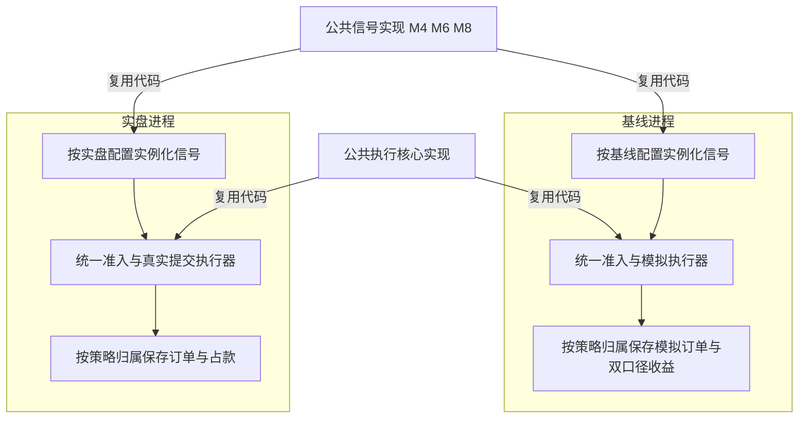

# 多信号实盘与基线共用执行架构

确认日期：2026-11-11，北京时间。

状态：用户已确认架构方向，多信号改造尚未实施。本次授权范围为记录架构，供下次变更参考；运行代码、配置、服务和停机标记保持现状。

## 已确认的进程与代码结构

实盘和基线分别运行在不同进程中。两者复用公共信号库与执行核心的实现代码，各自按配置接入一个或多个信号，例如 M4、M6、M8。

每个进程内由一个执行引擎承载多个独立信号模块，共享该进程的公共行情输入、时钟和基础资源。实盘统一管理余额读取、总额度预留和下单通道。基线使用模拟执行适配器及模拟资金规则。

两个进程独立选择信号集合，彼此不要求完全相同：

| 场景 | 实盘启用信号 | 基线启用信号 |
|---|---|---|
| 当前接入形式 | M4 | M4 |
| 新信号先验证 | M4 | M4、M6 |
| 三种信号并行 | M4、M6、M8 | M4、M6、M8 |

表中后两行是目标能力示例。新增信号实现一次，再分别决定是否接入实盘和基线。

## 信号与执行的职责

信号模块根据因果可得的公共行情生成下单意图：策略身份、市场、token、方向、Maker目标价格、确认时刻、有效期、失效条件、唯一机会ID及证据引用。信号决定何时、何价提出入场操作。

公共执行核心负责行情和价格合法性、post-only准入、数量计算、额度预留、签名、最终POST防护、ACK／REJECTED／UNKNOWN处理、重试、持久化与重启恢复。目标价格必须通过该策略对应的执行合同检查。

实盘执行器发送真实POST；基线执行器保存模拟POST并应用成交模型。ACK始终是提交应答。官方结果用于基线模拟收益结算，不能由ACK推断实际成交或实盘PnL。

## 单次入场与库存边界

每个信号对应一次独立的逻辑入场操作，订单随后按执行合同保留并等待市场结算。策略没有基于库存继续卖出、对冲、Merge、再平衡或选择退出时机的逻辑。

异常重试属于原操作，仍受原机会、方向名额和总占款限制；一次逻辑操作可能包含多次合规POST。是否按时间撤单属于执行合同，不能由“信号无退出逻辑”推导为新增或取消撤单行为。

多个策略买入同一token时，账户中的数量可以合并存在，入场决策无需维护按策略拆分的实时库存。账本继续保存“策略 → 信号机会ID → 订单ID → 提交状态与占款”，用于防重复、额度控制、审计及基线收益归因。

## 独立状态与共享资金

- 同名信号复用实现代码；不同模式、不同策略各自创建状态实例。候选、有效期、已消费机会和方向名额互不覆盖。
- 订单、日志、账本身份和恢复状态至少按模式、策略、市场区分；重启沿用原订单身份和全部未释放占款。
- 同钱包实盘需要原子的总额度预留，同时保留各策略独立额度。统一预留不引入账户互斥、实际成交核对或库存管理。
- 下单任务独立异步推进，某笔POST等待或超时不能阻塞其他策略。预留、幂等与最终POST检查仍须保证一致性；尤其要验证M6较短有效期下的提交延迟。
- 信号模块故障应可单独停用；公共行情、资金或执行完整性故障应统一阻止受影响的新增实盘操作。
- 基线不依赖实盘启动。实盘的人工或余额保护停机持续有效，不应因基线运行、信号配置变化或代码更新而解除。

同名策略对照时，应固定相同信号定义和参数。独立进程具有各自的输入接收时序、准入与POST群体，不能仅因共用代码就宣称实盘与基线产生完全相同订单。基线内部的新旧曲线继续使用同批模拟POST。

## 2026-11-13 补充：连续实盘按市场隔离故障

用户明确：各 PM 市场相对独立，上一场的风险状态与错误状态不应成为下一场的
自动停机条件。严重异常的持久停机也限定于发生异常的市场。

- 交易状态、信号预算、方向名额、重试和严重异常停机标记按市场身份隔离；下一场
  从自己的新状态和每场额度开始，不继承上一场的错误计数或停机标记。
- 单场严重异常必须持久记录，重启后仍禁止在该场重新开仓；下一场可以独立启动。
- 上一场的 UNKNOWN／待确认成交保留原订单身份和证据，仅对所属订单继续只读核对。
  不因它尚未查清而全局禁止下一场，也不能把旧信号、补单或预算搬到下一场。
- T240 后禁止该场新增买入。过期场次的核对只能更新历史事实，不得触发任何补单。
- 市场隔离不删除实际成交、扣款或未确认资金事实。新场仍须读取新鲜的账户余额与
  授权额度，并通过原有资金准入检查；人工停机和账户余额保护保持账户级作用域。
- 新场仍须满足自身的网络、行情、时钟和持久化条件。共享设施当前不可用时，准入
  检查可以阻止新增订单，但不能单凭旧场曾经发生过故障给新场附加停机标记。

本补充修正此前连续运行评估中“旧场 UNKNOWN 全局拦截下一场”及“所有严重异常跨场
持久停机”的建议。

2026-11-13 已在 M4 普通连续实盘入口落实以下机制（未启动实盘）：

- 严重异常写入本场账本旁的 `.halt.json`，独立于 SQLite 和交易日志。先创建并同步
  禁买标记，再原子保存原因；空白、损坏的标记同样禁止买入，禁止通过重置内存解除。
- 实盘运行循环在异常收尾前先禁买，最后的原生 POST 检查也检查该状态；已经发出的
  请求仍按原订单身份记账和核对，不通过取消异步任务假定其未发送。
- 同场重启使用原账本恢复，仅核对所属订单，新信号、零成交重试和部分成交补单均禁用。
  普通连续入口在本场异常后重新进入只读恢复；下一场重新创建执行器和预算。
- 已结束的故障场交由历史只读核对处理，其准备阶段的重试不再固定后续市场。
- 恢复元数据或账本校验失败也记录本场禁买，保留原账本；无法核对时保留未决状态。
  普通连续入口可等到下一场重新准入，单场和首笔试跑入口保留原停止边界。
- 历史核对使用独立网络健康状态和独立可变查询状态，诊断单列为
  `sm_m4_archive_network`；旧单查询超时不再修改当前市场的准入网络状态。
  HTTP 基础设施仍共享，新场自身请求失败依然执行原网络保护。
- “首笔成交后停”的专项试跑保留原结束条件，区别于普通连续运行入口。

实现位于 `m4_live_halt.py`、`m4_run.py`、`m4_live_budget_market.py` 和
`m4_live_startup.py`。离线验证覆盖故障后重启、UNKNOWN 部分成交只读恢复、原生 POST
边界、心跳失败后的任务收尾、残缺标记、下一场重新准入及历史查询网络隔离。
价格、费用预算、最小下单量和 T240 限制保持原合同；基线执行循环未修改。

## 实施前待确定的合同

1. 每场10 USDC是各策略分别的额度，还是三策略共用的总额度；各自10意味着合计可能达到30，当前M4的每场10限制不能被隐式放大。
2. 实际接入的M6、M8信号定义、参数及版本。
3. 各策略挂价、信号到期前准入、拒单重挂及时间撤单规则。M6/M8研究执行与M4现行实盘存在差异，接入时需明确选择，保留原有M4行为。
4. M6/M8基线采用何种模拟成交模型。M4仍沿用现有蓝色新口径与橙色旧口径两条曲线，不因架构记录增加曲线或改写历史事实。

## 当前代码与后续改造位置

当前通用化工作尚未完成。主要入口仍固定为M4，M6/M8现有研究状态机可作为适配来源：

- [M4运行入口](../../src/polymaker/m4_run.py)：模式选择、固定数据根目录、runner锁、信号与执行器装配。
- [M4信号](../../src/polymaker/m4_signals.py)与[M6和M8研究信号](../../research/maker_signals/strategies.py)：统一信号接口、状态隔离及实时输入适配。
- [M4执行](../../src/polymaker/m4_execution.py)与[风险账本](../../src/polymaker/m4_state.py)：策略身份、独立机会与额度、总资金预留和恢复。
- [停机控制](../../src/polymaker/m4_control.py)：按模式和策略启停、全局实盘现金保护。
- [基线快照](../../ops/m4_pnl_snapshot.py)、[小时巡检](../../ops/m4_pnl_hourly_watch.py)与[日志维护](../../ops/m4_log_maintenance.py)：多策略输入、目录、汇总和容量管理。

初步工程估计为4–7个开发人日，以复用已有信号为前提，另需至少24小时多信号基线运行验证。重点验证同时触发时的额度竞争、短有效期、拒单与UNKNOWN重试、崩溃恢复、停机标记、T240边界、内存和日志增长，并确认单独启用M4时与原行为一致。

现行M4交易与运行合同见[M4实盘与基线说明](../development/M4_LIVE_BASELINE_CUTOVER.md)。本方案适用于Maker入场信号系统，与历史Dynamic Exit EV研究架构分别维护。
