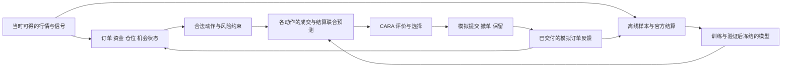

# M1234 CARA 决策层设计方案

日期：2026-11-08，北京时间。状态：设计完成，尚未实施或启用。

目标是让同一交易机会在经历等待、部分成交、撤单和新行情后，重新决定是否继续挂单及如何使用剩余预算。当前 M1234 固定规则基线继续采集，作为后续同行情对照。第一版面向 M2、M3、M4，保留 M1 两个执行版本作为独立基线；接口为后续 M1 和新策略复用。

建议先实现有限动作的 CARA 评价器：原价继续等待、撤单，以及明确撤单后最多一次原价重挂。保持初次入场规则和方向预算，先识别等待与重试的价值；改价、改变初始数量、跨市场连续资金随后作为单独实验。模型训练在离线完成，运行期只更新状态、使用冻结参数决策。

## 1 当前基线与复用边界

当前基线：`research_outputs/m1234_sim/forward/24h-20261108T114659-d8ab11`，观察窗口从 2026-11-08 11:50 起。运行身份为 `f27e3d45-b282-4e5a-a55b-929cdbc9d30c`，模型 `m1234-queue-v5`，输入 schema 2。完整计划见该目录 `plan.json`。

| 现有组件 | 已有能力 | CARA 阶段需要补齐的部分 |
| --- | --- | --- |
| `events.py` 和 `runner.py` | 原始行情、可得时间、输入顺序、记录过的 TIMER、回放 | 衍生实验身份、冻结模型清单和独立实验运行器 |
| `signals.py` 和原检测器 | M1 与 M234 独立信号、候选及失效事件 | 入场候选与持单有效性分开；失效原因细分及引用 |
| `M234Policy.poll` | 固定入场、候选消失撤单、方向尝试去重 | 可重复评价的执行机会状态、有限重试、动作选择 |
| `SimBroker` | 延迟、FIFO 排队、部分成交、撤单在途、资金与仓位守恒 | 复用撮合经济规则；新增只读观测适配，禁止策略改写队列 |
| `Store` | `audit(seq,input_seq,kind,payload)`、快照和身份 | 决策状态、各动作预测、选择理由、模型版本与恢复状态 |
| `calibration.py` | 本地真实与模型成交关联、数量和等待时间比较 | 未成交订单、有效暴露区间、退出原因、概率拟合与样本外验证 |
| `report.py` 和巡检指标 | 信号、订单、成交、未决、资金和结算 | 机会级结果、重试链、动作收益比较及模型校准指标 |

`M234Policy` 当前在 `broker.submit()` 后立即把 `(strategy,outcome)` 放入 `used`；未成交不自动恢复方向名额。账户按市场、profile、排队情景独立初始化，当前不是滚动资金组合。候选信号尚不是经过校准的结算胜率。现有 `calibration.py` 明确返回 `UNCALIBRATED`，不能将成交记录比较接口视为已经训练的预测器。

基线源码身份覆盖整个 `src/polymaker/**/*.py`，每个市场初始化都检查文件集合和哈希。运行中即使只新增一个 Python 文件，也可能使下一市场身份校验失败。因此本次只增加设计和检查证据；后续实现使用独立代码副本、独立配置和独立输出，保留当前目录及原始输入。本次不改变旧 M1 实盘、M2 study、dashboard 或巡检安排。

## 2 两类反馈及职责

**市场内反馈**在下一次决策时立即生效。未成交意味着等待年龄增加、剩余结算时间减少；队列可能前进，资金仍被占用。部分成交改变持仓、剩余量和可用预算。撤单确认、迟到成交或数据缺口改变可执行动作。

**跨市场学习**更新模型参数。完整订单暴露、公共行情和官方结算组成训练样本，按时间划分训练、验证和留出测试，得到新的模型版本。上线一个研究版本后冻结参数；同一天跑出的收益不回灌给此前的决策。



各模块承担不同职责：预测器估计可能发生什么；CARA 表达风险偏好；动作约束控制哪些操作允许执行；模拟交易所负责推进订单及账本。增加 CARA 不改变公共成交量、排队分配、费用定义或信号检测门槛。

## 3 决策目标与概率模型

令 `s_t` 为当时可知的状态，`a` 为本次动作，`π0` 为预先固定的后续处理方案。评价到该五分钟市场官方结算的收益分布：

```text
CE_gamma(s_t, a; π0) = -log E[exp(-gamma * Pi_T) | s_t, a, π0] / gamma
a* = argmax CE_gamma(s_t, a; π0),  a 属于合法动作集合
```

`gamma > 0` 的单位为 `USDC^-1`；`gamma = 0` 使用期望收益极限，作为区分风险偏好贡献的对照。收益可以用自市场账户初始化以来的总 PnL，已经确定的历史成本在各动作之间一致。不得把剩余订单孤立计价而忽略既有库存及其他同账户订单。

对于二元结算，统一在每条联合情景中计算：

```text
Pi_T = cash_T + inventory_YES_T * Y + inventory_NO_T * (1-Y) - initial_cash
Y 属于 {0,1}；cash_T 已扣除实际模拟成交成本及已确定适用的费用。
```

预留是现金的一部分，不能既扣现金又把预留再扣一次。未来成交数量、成交时刻、价格、信号失效和结果 Y 需要联合描述。同一市场的 YES 与 NO 共享同一个 Y，不能各自独立抽取输赢；不同策略的独立反事实账户也不能合并成组合收益。

第一版按现有 `GROSS_UNTIL_MARKET_RULE_VERIFIED` 费用口径输出毛收益 CE，不宣称净收益。费用口径发生变化时，全部对照采用同一份经过确认的规则并另立版本。

CARA 指数效用与成交强度结合以选择报价的理论基础见 [Avellaneda 与 Stoikov 原论文](https://math.nyu.edu/inmemoriam/avellaneda/HighFrequencyTrading.pdf)。本方案采用二元官方结算和显式排队；不直接照搬原文的连续价格、双边做市或临近终点库存风险公式。结算时间临近本身不保证二元仓位风险趋零。

### 3.1 预测器的最低输出

| 输出 | 用途 | 必须处理的依赖 |
| --- | --- | --- |
| `p_any_fill` 和首次成交等待分布 | 比较保留和撤单 | 已等待年龄、队列估计、价格相对盘口、近期主动流 |
| 成交数量分布 | 部分成交、资金与风险 | 不以单一平均成交量代替随机数量 |
| 失效与行情演化 | 延长等待后的有效性 | 软到期、锚价破坏、反向证据、质量中断 |
| 结算结果 Y 与成交路径的联合分布 | 评价成交之后的价值 | `P(Y=1 | 成交路径, 状态, 动作)` 不默认等于入场时胜率 |
| 覆盖、区间和模型外状态 | 处理估计不可靠 | 有效独立市场数、状态支持度、训练期和可得时间 |

价格上涨导致排不到单与价格下跌导致更易成交，可以对应完全不同的结算收益。不能用一个独立的成交概率乘一个固定信号胜率来替代这个联合模型。

### 3.2 第一版建模方式

从少量可解释特征和分层模型开始，避免立即训练大型端到端模型：

1. 用所有合格机会的公共特征与官方结果拟合结算概率，包含未发单和未成交机会；盘口价格只能是特征或明确标注的基准，不能直接当成真实概率。
2. 用订单有效暴露区间拟合首次成交的条件发生率、部分成交量和失效转移。状态至少含策略、报价区间、剩余市场时间、订单年龄、队列前量及其变化、主动流和信号有效性。
3. 联合抽样短期盘口与订单路径，并使用路径末端状态估计 Y；或使用仅来自训练市场的条件路径样本。各候选动作使用同一组外生样本，减少比较噪声。不得从当前测试市场的真实未来选路径。
4. 以现有撮合器约束每条假设路径中的订单到达、队列和成交量。预测过程的虚拟分支使用独立账本，不写回主模拟账户；实际执行结果始终由随后真正到达的公共输入驱动。

订单流强度依赖盘口状态的建模思路可参考 [Huang、Lehalle 与 Rosenbaum 的 queue-reactive 模型](https://arxiv.org/abs/1312.0563)。采用这种结构是否有效，须由本市场数据验证。

预测模型未达到覆盖和验证条件时，只输出缺项和观察记录。不能用任意胜率启动 CARA 决策。观察阶段跟随基线；实验决策阶段遇到模型外状态，停止新增风险，并按预先声明的保留截止和撤单规则处理已有订单。

### 3.3 继续价值与风险参数

第一版采用有限动作滚动评价，不要求通用 HJB 求解器。每次比较完整的继续方案：本次动作持续到下个复核点，之后遵循同一个冻结的 `π0`，直至撤单完成及官方结算。`π0` 的机会截止、剩余重试、已成交量和资金必须一起推进；不能把“等待”评估到结算、把“撤单”只评估到下一秒。

初始 `π0` 可明确固定为：有单时保留到硬失效或绝对截止；空仓挂单状态下，只有后续新出现的有效入场证据、剩余物理额度和预算同时成立，才在下一个可得决策点按原价提交剩余量；其余情况等待到截止；全部已成交仓位持有到结算。候选重复推送不算新的入场证据。等待与重挂分支都使用这个定义，版本中保存 `continuation_version`。这只评价当前市场剩余机会；当前账户每场重置，因此不虚构把释放的资金用于下一市场的收益。

实际下一复核时允许用新信息重算。这是近似控制，报告模型版本和继续方案，不宣称已获得全局最优。撤单后可能重挂时，继续价值包含这个分支；若当前版本不允许再交易，则明确该分支为零。

`gamma` 来自风险偏好与可承受损失，不能由一次未成交自动提高，也不能只选测试收益最高的 gamma。研究可预注册 `gamma * B_ref` 为 `0、0.1、0.3、1` 的敏感性网格，其中 `B_ref` 固定为该策略方向预算；该网格不是已确认的最优参数。数值实现使用 log-sum-exp；小 gamma 检验应趋近期望收益。

## 4 数据契约与可得时间

所有接口携带 `market`、`token`、`generation`、`input_seq`、`available_mono`、schema 和版本。跨市场比较另带 UTC 时间；单市场等待时长使用单调时钟。金额、价格、份数使用十进制定点或 Decimal 字符串。

| 数据组 | 最低字段 | 当前来源及新增需求 |
| --- | --- | --- |
| 公共行情 | 双边盘口、档位量、直接成交方向/价格/量、源时间和接收时间、tick、generation、断流 | 现有压缩输入与 Signals；复用直接成交和互补派生流去重规则 |
| 信号 | 原 candidate ID、root、strategy/version、方向、锚价、证据 ID、出现和原到期时间、失效原因 | 原 `SIGNAL` 审计；需补原因子类与当时证据，保留检测器原定义 |
| 订单事实 | 物理订单 ID、机会 ID、retry_of、意图、到达/回执、部分成交、撤单请求及生效、拒绝、UNKNOWN | 原 broker 审计；新增供策略读取的可得观测视图 |
| 排队估计 | 估计前量、推进量、订单年龄、价格距离、估计情景与质量 | 原始行情重建及 `QUEUE_JOIN` 等模型事实；明确是推断，不是交易所 L3 真值 |
| 账户 | 已确认现金/持仓、已支出、预留、在途金额、未知敞口、方向剩余预算 | 原 Account 与 Order；新增机会和方向预算聚合 |
| 未成交暴露 | 每段开始/结束时间、仍在排队的剩余量、退出原因、首成与全成标记、证据类别 | 新增离线提取器；不能只从有成交的订单建表 |
| 结算标签 | 官方 market 身份、winner、首次取得时间、验证状态 | 现有 `OFFICIAL_RESULT` 和 `SETTLE`；null/待定不填 0 |
| 真实校准 | 原订单量、提交/回执/撤单、每笔成交 ID、可靠时间轴、完整性说明 | 已有本地导入接口只部分支持；完整生命周期是独立数据依赖 |
| 实验身份 | 输入哈希、代码/配置/信号/队列/模型哈希、训练截止、费用与证据口径 | 扩展独立实验 manifest，禁止覆盖原基线身份 |

未成交预测所需的行情和模型订单大部分已经采集，可以离线提取；真实排队位置、真实取消和真实成交的完整对照仍然缺失。无需为设计或公共模拟加载钱包、订阅真实账户或调用真实下单接口。

### 4.1 策略可读状态与模拟器内部状态

`ClientObservationAdapter` 只交付在当前输入水位之前已经可得的事实，保留 `occurred_at` 和 `available_at` 两个时间。M234 目前没有统一的成交与撤单反馈订阅接口，需要新增，不能让新策略直接遍历 broker 的未来 timer、未来回执或评分分支状态。

公共行情推导的 queue estimate 标记 `MODEL_ESTIMATE`；模型成交和模型撤单反馈标记 `MODELLED_FEEDBACK`；真实校准记录才可标记 `ACTUAL_*`。决定采用何种反馈交付延迟时，冻结为实验配置；所有新决策对照使用同一交付约定。若该约定与旧基线不同，另外报告适配层差异，不能把时序变化的收益归功于 CARA。

同一 TIMER 的顺序保持显式：推进已到期的模拟事件、交付可得反馈、更新信号和状态、评估合法动作、提交本轮动作。动作不能回到本轮之前成交；取消请求到真正生效前仍可能有成交。重启恢复后使用持久状态及输入水位，不重放已经执行的动作。

## 5 机会状态与挂单有效性

新增 `ExecutionEpisode`，第一次合格机会建立，按市场、策略和方向绑定一个预算。原 candidate ID 变化不自动新增方向预算，也不能清零等待时长和重试次数。

```text
episode_id / strategy / outcome / candidate_roots[]
first_candidate_at / first_submit_at / original_deadline / absolute_deadline
entry_valid / holding_validity / end_reason / evidence_refs[]
initial_quantity / filled_quantity / live_remaining / unresolved_quantity
budget_cap / spent / reserved / unresolved_reserve_included
physical_posts / max_physical_posts / active_order_ids[] / last_decision_id
```

`holding_validity` 为 `VALID、SOFT_EXPIRED、HARD_INVALID、UNKNOWN`。这是执行研究层对证据的解释，原信号检测器仍照旧产生和结束候选，报告明确标记“候选已结束但执行许可尚在”的时段。

| 原因类别 | 初始动作边界 | 判断证据 |
| --- | --- | --- |
| 只有计时器到期 | 可进入有限等待评价，需其余持单条件成立 | 精确组件到期时间，盘口仍有效，原价与支撑证据仍满足版本化条件 |
| 原支撑价位消失、反向结构被确认、市场身份/tick 不可用 | 撤单或停止新增风险 | 对应输入与组件事件；不能用 CARA 分数越过硬条件 |
| 新候选替代旧候选、best bid 改变 | 逐策略规则分类；首版未能解释时按不可延长处理 | 原锚价仍否存在、是否仍为同一经济机会 |
| `CA_ENDED`、`COMPONENT_UNAVAILABLE` 等笼统事件 | 原因未细分前不开放延期 | 它们可能同时包含到期、支撑丢失、价格变化或数据问题 |
| 断流、时序矛盾、未知订单 | 保留未知风险，停止补单 | 质量与订单事实，不标成明确未成交 |

尤其 M4 的 `COMPONENT_UNAVAILABLE` 同时覆盖缺少 support/DF、盘口不可用及原支撑档消失；M3 的 `CA_ENDED` 也可能包含多个底层原因。简单把这些事件全部视为“软到期”会改变策略含义。

延长等待采用固定的绝对上限，不滚动刷新：

```text
absolute_deadline = min(T240,
    max(original_deadline_captured_at_first_submit,
        first_submit_at + configured_minimum_lifetime))
```

`configured_minimum_lifetime` 的研究对照为 5 秒或 10 秒。原期限已经更长的订单不被无意缩短；任何硬失效仍提前撤单。首版保守地在 T240 发撤单请求、不再新增风险，撤单在途照常撮合，T300 后仍无法确定的尾部保留 UNKNOWN。与旧策略可能持续更久的 GTC 行为存在差异时，单独列出，不混入“纯延时改善”。

## 6 动作集与未成交反馈回路

第一版保持初次发单的原价、原数量算法与原门槛。第一笔实际模拟发出后，才交给新执行层管理。

| 动作 | 含义 | 限制 |
| --- | --- | --- |
| `KEEP` | 保留当前订单及队列位置，到下个复核点再评价 | 仍在有效许可和绝对截止内；不会伪造新订单 |
| `CANCEL` | 撤销未成交余量 | 已成交仓位持有到结算；撤单请求不等于完成 |
| `WAIT_FLAT` | 明确没有活动单时暂不发单 | 不改变原机会截止与预算；过期即结束 |
| `REPOST_SAME_PRICE` | 明确撤单或明确拒绝后，在原价重新提交剩余量 | 重新检查入场/执行许可、maker 条件、tick、最小量和资金；不继承旧队列位置 |
| `END_EPISODE` | 结束该机会的新增挂单 | 继续记录现有仓位结算和未知风险 |

初始研究上限为每个市场、策略、方向 **最多 2 次物理提交**，即首次加一次重挂；明确拒绝也占物理次数，UNKNOWN 不允许补单。同一方向同一时刻最多一个活动或在途订单。另一方向独立许可，但共享该策略账户资金，并在效用中联合评价 YES/NO 风险。

方向资金约束按所有尝试累计：

```text
已成交支出 + 当前有效预留 + 尚未计入预留的未知风险 + 拟新单最大支出 <= 方向预算
同一未知金额只计一次；不能通过新候选或重试归零。
首版所有尝试累计成交量 + 当前剩余潜在成交量 <= 初始计划数量。
```

CARA v1 不原地修改订单数量。需要减少暴露时先撤单；未来允许减量或改价，也要按交易所语义明确是否失去排队优先级。未来价格实验可用有限 tick 集合，但不能在 v1 把追价和延长等待同时引入。

每个合法 TIMER 上先执行硬约束，再按反馈触发或达到复核间隔运行评分。建议计算间隔初始为 250ms，实际只落在已经记录的 TIMER 上；部分成交、确认取消或硬失效可在下一个可得 TIMER 优先处理。纯计算预算和节流属于实验参数，须压测，不能扩大输入队列补偿慢决策。

```text
state <- reducer(public_events, delivered_order_events, episode_state)
if hard_invalid or deadline_reached:
    request_cancel_if_needed(); record(reason); stop_new_risk
else:
    actions <- admissible_actions(state)
    predictions <- frozen_model.predict_joint(state, actions, π0)
    if insufficient_support or stale_snapshot:
        execute_predeclared_fallback(state); record(missing_reason)
    else:
        scores <- cara.evaluate(predictions, gamma)
        chosen <- select_with_uncertainty_and_switch_threshold(scores)
        execute_once(chosen, decision_id, expected_state_version)
```

保留原单时保留已积累的队列价值，重挂时重新估计到达后的前量。若差异小于预测误差或预设的换单门槛，优先保留当前合法动作，避免不停撤挂。门槛和误差带由训练/验证阶段固定，不用测试收益反推。

## 7 一个部分成交后的重挂例子

以下为接口演示，假设价格、tick 和最小数量均合法，不是本轮观测结果。

| 时刻 | 已知事实 | 下一轮状态及允许动作 |
| --- | --- | --- |
| T40 | 原价 0.10，计划 50 份，预算 5 USDC，首次提交 | 记录机会与截止；前量估计来自当前可得盘口 |
| T42 | 未成交，但前量由 500 降至 40，持单条件仍有效 | 更新等待年龄与队列；比较 KEEP 和 CANCEL，不能只因等了 2 秒就判失败 |
| T43 | 已交付成交 20 份，随后发出撤单请求 | 已支出 2 USDC，余量 30；进入 CANCEL_PENDING，不允许立刻再挂 50 份 |
| T43 之后 | 撤单在途又成交 5 份，之后收到可证明取消的反馈 | 累计成交 25，支出 2.5；释放已确认取消的余量预留 |
| 下一次决策 | 原机会仍有效，截止未到，尚有一次物理提交额度 | 可比较 WAIT_FLAT、结束和原价重挂至多 25 份；重新排队，机会截止不顺延 |

如果撤单反馈不确定，最后一行的重挂动作不会进入合法集合。已经成交的 25 份继续持有到结算，并与潜在新增成交共同进入 CARA 评价。

## 8 未成交样本如何进入训练

同时保留机会表、物理订单表、暴露区间表和成交明细表，避免只研究已经成交的样本。

| 样本情况 | 标签处理 |
| --- | --- |
| LIVE 后 3 秒确认撤单、期间无成交 | 记录有效暴露 3 秒、零观察成交和取消原因；不生成 5 秒/10 秒的真实零成交标签 |
| 部分成交后撤单 | 首次成交是已观察事件；剩余数量的完成时间被截断，保存分批数量 |
| 信号恶化导致撤单 | 保存当时特征和退出原因；取消由行情驱动，不能假设与未来成交独立 |
| UNKNOWN、断流或失效市场 | 标记不完整，给出缺口；不能填入明确未成交分母或结算零收益 |
| 没有发单的合格信号 | 可用于信号结算校准；不能冒充真实订单的成交暴露 |
| 同一输入下的多个执行/排队分支 | 标记 `MODELLED_COUNTERFACTUAL`，按原市场聚类；不能当作独立真实订单扩充样本量 |

观察截止之后的事件时间缺失属于右删失，基本定义见 [NIST 删失数据说明](https://www.itl.nist.gov/div898/handbook/apr/section1/apr131.htm)。本任务的主动撤单还存在策略选择偏差；拟合时应将原因和状态纳入退出模型，或者限定估计目标为当前策略下的条件结果，不能无条件外推无限等待。

公共输入在旧单取消后仍持续记录，因此可以在独立反事实分支里试算“若继续挂到 5/10 秒”的队列结果。它使用冻结撮合假设，是研究标签，不是真实未成交订单的补全事实。新策略在测试回放中只能逐事件决策，不能预读该分支未来结果。

未成交是现有公共流与队列模型的推论时，不应把“零成交”再当成一条独立外部证据重复更新胜率。它最直接改变时间、队列估计、占款和可选动作。只有经过条件建模并验证的新增信息，才影响方向预测。

## 9 拟新增接口

下面是设计接口名，尚不存在可调用的 CARA 实现。

| 接口 | 输入 | 输出与不变量 |
| --- | --- | --- |
| `FeedbackReducer.apply(event)` | 已交付公共与订单事件 | 单调 state_version；按事件身份去重；不重复扣款/计成交 |
| `DecisionStateBuilder.snapshot(asof)` | reducers、信号、质量和账户 | 不可变 DecisionState，所有证据不超过 asof 水位 |
| `HoldingValidity.evaluate(state)` | 原信号证据和当前盘口 | 持单有效性、细分原因、绝对截止；不重写检测器 |
| `ActionGate.enumerate(state)` | 状态与风险/重试配置 | 合法动作及被过滤原因；UNKNOWN 不能变成可补单 |
| `JointOutcomeModel.predict(state, actions, continuation)` | 冻结模型、训练截止和动作 | 联合情景、权重、覆盖与不确定性；不访问未来输入 |
| `CARAValue.evaluate(state, forecasts, gamma)` | 同账户终端 PnL 情景 | 各动作 CE、期望 PnL、尾部损失、缺项；稳定数值计算 |
| `ExecutionPolicy.choose(state, scores)` | 合法动作与评分 | 有明确理由的一个动作，含基准比较和回退原因 |
| `SimActionGateway.execute(action, expected_state_version)` | 带 decision_id 的动作 | 幂等提交/撤单或状态过期拒绝；只调用模拟 broker |
| `DecisionAudit.append(record)` | 状态引用、所有候选评分和实际动作 | 可回放、可追溯；不能只存最后选中的动作 |
| `EpisodeDataset.export(watermark)` | 已提交审计、输入引用、结算标签 | 机会/订单/暴露/结果表及缺项，不写原基线库 |

关键数据结构草案：

```text
DecisionState
  schema, experiment_id, policy_version, model_version
  market, strategy, profile, queue_scenario, episode_id
  asof: {input_seq, audit_seq, available_mono, generation}
  signal: {candidate_id, root, original_deadline, holding_validity, evidence_refs}
  book: {bid, ask, tick, source_age, direct_flow_features}
  orders: [{physical_id, client_state, filled, remaining, available_at,
            cancel_pending, uncertain, queue_estimate, estimate_quality}]
  account: {cash, reserved, inventory_yes, inventory_no, unknown_exposure}
  limits: {budget, spent, physical_posts, max_posts, absolute_deadline}
  quality: {status, missing_fields, coverage_gap_refs}

ActionForecast
  action_id, action, horizon, continuation_version, state_hash
  joint_model_hash, train_end_available_at, scenario_ids, weights
  p_any_fill, fill_quantity_distribution, terminal_pnl_samples_or_ref
  expected_pnl, ce_usdc, uncertainty, support_count, evidence_basis

DecisionRecord
  decision_id, state_hash, input_watermark, model_hash, gamma
  considered_actions[], filtered_actions[], selected_action, reason_codes[]
  expected_state_version, gateway_result, supersedes_decision_id
```

建议理由码包括 `QUEUE_PROGRESS_WAIT`、`INSUFFICIENT_JOINT_EDGE`、`PARTIAL_FILL_REMAINING_BUDGET`、`SOFT_EXPIRY_LEASE`、`HARD_INVALID_CANCEL`、`UNKNOWN_EXPOSURE_BLOCK`、`RETRY_LIMIT_REACHED`、`MODEL_OUT_OF_SUPPORT` 和 `NO_MATERIAL_CE_GAIN`。理由必须对应状态证据和实际评分，不能仅凭标签推断原因。

## 10 与当前代码的接入位置

后续在隔离副本里新增 `decision_state.py`、`decision_models.py`、`decision_policy.py` 和实验数据提取器；名称为拟议实现边界，不写入当前运行源码。

1. `Engine` 在既有 TIMER/POLL 决策入口通过 policy factory 选择原固定规则或新策略。旧路径可完全保留，先证明原算法回放一致。
2. 新策略通过观测适配器接收 broker 事件，操作网关调用现有 `submit/cancel`。`OrderIntent.retry_of` 可复用；原 `signal_version` 保存原检测版本，新增独立 `policy_version`，避免把执行变化混写成信号变化。
3. 用 ExecutionEpisode 取代新策略内部的单次 `used` 开关；原固定策略的 `used` 规则保留。新的 root/candidate 不得规避市场方向总额度。
4. `Store` 增加 `DECISION_STATE_REF`、`ACTION_EVALUATION`、`DECISION`、`CLIENT_OBSERVATION`、`EPISODE_TRANSITION` 等版本化事件。金额和订单事实仍由 broker 审计主导，不另造一份可独立漂移的经济账本。
5. 快照保存 episode、已处理水位、重试次数、模型哈希、决策去重状态和必要随机状态。恢复使用相同冻结模型，不能重算后重复提交。
6. 当前 `runner.settings()` 拒绝未知配置键。新配置通过明确的实验 schema 接入，不能直接往现有 24h TOML 添加 CARA 字段。

评分计算先在离线回放完成。后续前向影子进程读取独立的有界输入副本；训练、远程模型请求和大规模情景生成不进入现有行情回调。特征增量更新，完整情景按引用保存，轻量决策记录只在评价时写出。资源上限和耗时预算须通过压测后确定，溢出留下失败事实。

衍生数据按原始输入哈希引用公共行情，不为每个策略分支复制一整套原始文件。暴露区间在状态变化处分段，不按每个行情帧写完整状态。记录单市场衍生字节数和决策频率后估算全天增量，再做磁盘预检；不先承诺未经测量的日志容量，也不删除当前或失败运行的原始证据。

## 11 基线与实验比较

当前基线持续运行。先完成现有样本采集，再按时间划分训练/验证/留出市场；失败运行中的有效市场可另列探索集，但不能与新轮拼接成连续 24 小时。

| 实验 | 保持一致的部分 | 回答的问题 |
| --- | --- | --- |
| B0 原固定规则 | 当前冻结实现、信号、撮合、原账户与原期限 | 精确复现基线 |
| B5 与 B10 有界规则等待 | 同信号、原价/数量/预算、细分硬失效，只改变允许等待 | 改进是否仅来自延长有效挂单 |
| D0 动态风险中性 | 同一动作集、模型、反馈延迟、预算，gamma=0 | 动态状态反馈是否有价值 |
| Dγ 动态 CARA | 与 D0 一致，只改变预注册 gamma | 风险偏好带来的收益与风险变化 |
| DγR 可选重挂消融 | 与 Dγ 一致，单独开/关一次重挂 | 效果是否来自更多物理尝试 |

先比较等待，再比较有界重挂；不能把 B0 对 Dγ 的全部差异都归因于 CARA。`trades-only` 作为主排队假设，`cancel-half` 作为敏感性结果，分别报告。两种情景不是等概率真实世界，不简单各占 50% 混成一个预测；若采用稳健最差情景目标，应另立版本。

每个执行版本在同一排队情景下使用独立反事实账户。同一版本内的多张订单共享可消耗量及资金；跨版本不互相抢量，也不相加为真实组合。M1 两个执行版本的结果继续分别报告。

### 11.1 回放身份

现有 `replay` 会依据 INIT 校验原实现，不支持任意替换策略。新增实验驱动器应只读原始输入，记录原文件哈希与 source definition，同时生成新的 execution definition、配置哈希和输出目录。原 INIT 与市场元数据保留作为来源证据，派生执行身份独立绑定，不通过关闭身份校验来运行新代码。

B0 使用原冻结源码与原 definition 回放，除允许归一化的非经济身份字段外逐事件对齐。实验版本引用相同市场、FRAME、可得时间和 TIMER；若新增决策节奏，只能是已记录 TIMER 的子集，并记录选择规则。不能在两个原始事件间插入仿佛当时实际执行过的机会。

### 11.2 训练与指标

训练仅用当时已取得官方结果的历史市场，`label_available_at < model_frozen_at <= test_start`。按市场和时间块划分，所有候选、两边 token、部分成交、重试及模拟分支归在同一分区；不随机拆订单。样本量使用独立市场/机会数，不能用行情帧数或分支数量代替。

主要结果是每个共同机会/市场的配对结算 PnL、CARA 确定性等价与风险分布，同时报告期望收益和尾部损失。当前独立账户模式可比较单市场 PnL 序列，不称为滚动账户的实际净值或回撤。

辅助指标包括机会到发单率、首次/全量成交等待、份数成交率、每机会物理提交数、取消次数、资金占用时长、1/5/30 秒 markout、未决比例、覆盖与排除原因。markout 是诊断，不替代结算收益。成交模型评价含概率校准、数量/等待误差；方向预测评价概率校准和 Brier/log loss，不能只看准确率。

所有未知和待定保留独立列及可能风险范围。报告共同可比样本的配对结果，也报告各实验全部机会与缺项，不能靠排除新策略的不确定订单使结果变好。区间按市场或连续时间块计算；终端 CE 的估计与不确定性必须随有效市场数一起报告。

24 小时是一次工程与采集窗口，不是模型已可训练的样本量保证。先统计有效机会、成交/未成交暴露、结算和分层覆盖，再预注册覆盖门槛、允许误差与换单阈值。达不到条件时保持研究/观察状态，不强行启用。

## 12 实施顺序与验收

| 阶段 | 交付物 | 通过条件 |
| --- | --- | --- |
| A 数据与机会状态 | 只读提取器、暴露区间、原因分类、数据字典 | 信号/订单/份数/预留与基线审计对齐；未知不填零 |
| B 冻结回放与动作状态机 | 原规则回放、ExecutionEpisode、幂等网关 | B0 复现一致；重试不超预算、不重置截止、不继承旧队列 |
| C 联合模型与评分器 | 冻结模型、覆盖报告、CARA 与 gamma=0 对照 | 时间无泄漏、预测校准、部分成交与二元结算联合一致 |
| D 同行情实验 | B5/B10、D0/Dγ、重挂消融及配对报告 | 改善超出估计误差，结果披露排队与费用假设敏感性 |
| E 独立前向影子运行 | 新目录、新身份、计算和日志预算 | 不影响现有基线，冻结模型、回放可复现、资源检查通过 |

必要定向测试围绕经济与时间不变量：

- 决策读不到未来成交、未来结算或尚未交付的回执；所有引用不超过水位。
- 未成交后的 KEEP 保留排队位置；撤后重挂重新入队；首笔后每次仍只能消耗剩余预算和数量。
- 撤单在途部分成交先入账；明确取消再释放余量；UNKNOWN 阻止补单。重复事件和恢复不能重复提交。
- 候选更换、断线重建、重试、进程恢复都不能重置方向预算和绝对截止。
- 同一情景中交易量不被多订单重复消费，YES/NO 结算互补，现金与份数守恒。
- `gamma→0` 接近期望收益；确定金额的 CE 等于该金额；同均值更分散的结果在适用的风险比较下不能获得更高 CARA 评价；大损失样本数值稳定。
- 相同输入、模型、seed 和动作版本生成相同决策；失效原因不明确、模型覆盖不足和评分超时触发可审计回退。
- 每份报告明确真实记录、模型事实和反事实分支，机会数不随重试或队列情景翻倍。

本次交付范围为上述设计及当前基线未改动的检查记录。数据提取器、模型拟合、回放实验和新策略运行属于后续实施工作。

## 13 代码与证据索引

- [当前策略适配](../../src/polymaker/m1234_sim/policy.py)：M234 单次方向尝试和候选失效撤单。
- [模拟撮合与账本](../../src/polymaker/m1234_sim/broker.py)：OrderIntent、Order、Account、延迟、FIFO、部分成交和未知风险。
- [事件决策入口](../../src/polymaker/m1234_sim/engine.py)：输入水位、TIMER/POLL、身份校验和官方结算。
- [录制与回放](../../src/polymaker/m1234_sim/runner.py)、[记录格式](../../src/polymaker/m1234_sim/events.py)、[审计存储](../../src/polymaker/m1234_sim/store.py)。
- [校准接口](../../src/polymaker/m1234_sim/calibration.py)、[结果口径](../../src/polymaker/m1234_sim/report.py)。
- [M3 与公共候选](../../src/polymaker/m234_signal.py)、[M4 frequency v2](../../src/polymaker/m4_frequency_signal.py)。
- [原模拟器设计](M1234_TRADING_SIMULATION_DESIGN_20261105.md)、[第一阶段验收边界](M1234_TRADING_SIMULATION_PHASE1_ACCEPTANCE_20261107.md)。
- [此前挂单寿命分析](../../research_outputs/analysis/m234_order_lifetime_20261108/result.json)：来自上一失败运行的有效市场，仅用于探索，不能混成当前轮连续记录。
- [本次基线保护检查](../../research_outputs/analysis/m1234_cara_design_20261108/baseline-before.json)：设计开始时运行身份、165 个源码文件及配置一致性。
- [交付检查](../../research_outputs/analysis/m1234_cara_design_20261108/validation.json)：文档链接、代码与配置一致性、原进程继续运行；单独记录期间观察到的巡检控制变化。控制文件记载 12:24 按用户要求停止旧对话自动巡检，模拟器继续运行，本次保留该设置。
