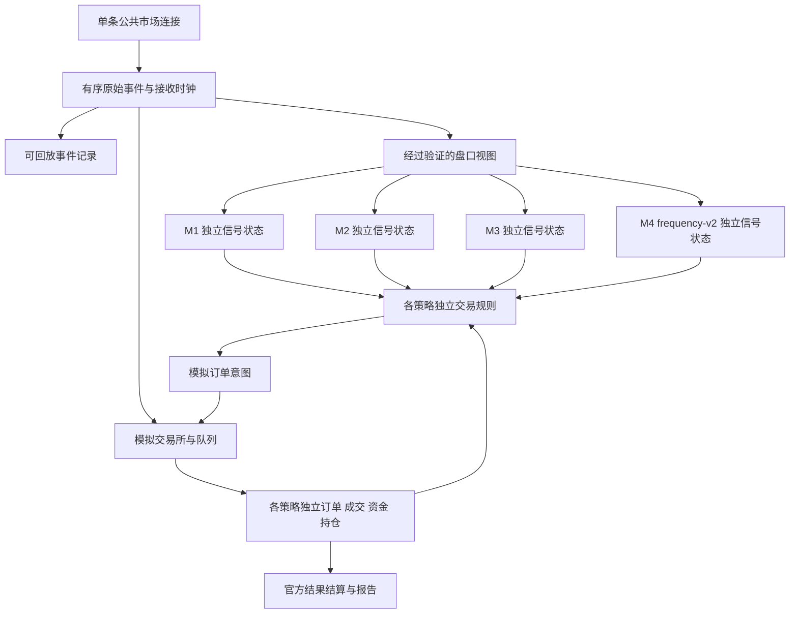

# M1234 交易模拟升级方案

日期：2026-11-05，北京时间。状态：可行性核对与开发设计，尚未实施新模拟运行器。

建议在当前 M234 公共研究入口上加入独立的 M1 观察器，复用 M1 的行情和提交前决策经验，并将历史 PaperBroker 的成交机制提取为通用模拟交易所。四类信号在同一条输入流上运行，各自拥有订单、资金和持仓账本。先复现固定交易规则下的成交与收益，再比较报价、存续和数量决策；HJB 与 CARA 留在策略优化阶段。

## 1. 当前实现核对

本次核对截至北京时间 22:20 左右，针对当时工作区源码和本机服务，不把历史文档中的部署描述当成当前运行状态。

| 部分 | 当前行为 | 可复用基础与缺口 |
| --- | --- | --- |
| M234 研究 | `m2_study` 以 `--include-m3-m4` 共用公共行情；M4 为 frequency-v2；按锚价假设足额成交、持有至官方结算 | 市场发现、时钟、候选、版本和官方结果可复用；缺少当前研究入口下的订单撮合 |
| M1 虚拟基线 | 公共实时行情；使用 `M1Market` 与实盘共用提交前代码；原生 POST 边界记录 `virtual_fill`，立即按全量计算 | 有明确的模拟传输接口；需要将提交回执与实际模拟成交分开 |
| M1 历史 PaperBroker | 可见队列、到达延迟、部分成交、撤单延迟、未知风险与二元结算 | 已有成交模拟原型，但绑定旧 M1 单活动订单、RF/EX claim 和信号到期撤单规则 |
| M234 真实执行模块 | 有订单归属、预留、成交核对与迟到事实处理 | 可参考记账语义，不能直接用真实 Gateway 充当公共模拟器 |

核对时 `polymaker-m1.service` 与 `polymaker-m2-study.service` 正在运行；查询到的用户级 `polymaker-m1-live.service` 为 inactive，系统级同名服务不存在。此结果不推断停止原因，也不代表检查了所有可能的外部进程。

M234 当前报告的版本为 `3486af25f7582a69c47bea07447ea0abc56507390b19690cc449de76e44e6620`，输出上限为 8192 MiB。M1 虚拟报告使用 0.01–0.19 价格范围；`config/m1-live/m1.toml` 当前设置实盘价格上限 0.09。不能将二者称作完全相同的现行交易配置。

代码证据：

- `src/polymaker/m2_study.py:M2Study.market`：T240 调用 `feed.close()`。
- `src/polymaker/m234_signal.py:M234Hub.__init__`：`feed.m1` 实际被赋值为 `M2Signals`。
- `src/polymaker/m2_signal.py:M2Signals.start_campaign`：AP_BUY 确认清除本检测器此前 RF 状态。
- `src/polymaker/m1_virtual_execution.py:VirtualExecutionClient._native_order_post`：记录 `FULL_FILL_AT_INSTRUCTION_PRICE`；`SharedVirtualPolicy.flush` 将其转成假设交易。
- `src/polymaker/m1_virtual.py:VirtualService.market`：T240 关闭行情，只写经过筛选的信号日志。
- `src/polymaker/m1_live.py:M1Market`：持久机会去重、提交前规则、重试；当前设置 `fill_tracking=NOT_TRACKED`，不根据成交释放提交占款。
- `src/polymaker/rdp_sm_m1_paper.py`：现有队列模拟原型。
- `src/polymaker/rdp_sm_m1_writer.py`：压缩原始事件记录机制，可作为新记录器参考。

## 2. 目标架构

“同一条行情”意味着共同接收事实与时钟，不意味着四个策略共用可变信号对象。新模拟器作为研究进程使用公共输入，不依赖实盘进程给它提供数据。后续若需要捕获实盘看到的精确输入序列，可通过有界异步输出提供只读副本；研究处理和磁盘写入不能阻塞实盘回调。

四个账本是四个反事实实验：各自假设单独运行在同一市场。它们的收益不能相加为一个实际组合。同一策略的多张模拟订单必须共同消耗该策略世界中的可成交量；以后做共用真实资金的组合时，还需统一分配资金和成交量。

## 3. 加入 M1 的具体方式

先抽出多观察器分发边界，再接入 M1，不能直接执行 `feed.m1 = M1LiveSignals(...)`，否则会覆盖当前 M2。

每个观察器具有独立的轮次、来源时间水位、信号编号、候选消费状态、失效状态和计时器。M2 的 AP 确认不能清除 M1 的 RF，M1 消费机会不能消耗 M2/M3/M4 候选。

当前 `SessionFeed` 的盘口接纳受 `feed.m1.before_event` 返回值影响。抽取公共接纳层必须验证 M1 与 M2 对同一原始序列的行为；在确认等价之前，允许在同一原始流上维护策略专用盘口视图，不能用 M2 已过滤的数据冒充 M1 原本会看到的全部输入。输入来自同一连接，策略状态和必要的视图相互隔离。

原始事件顺序、消息内子事件顺序与最终盘口发布边界均保留。新候选必须在完整消息更新和 BBO 核对后才能转为订单意图；不能在消息中间的暂态盘口成交。用可注入时钟重放计时器，按实际可得时刻形成信号，不按事后修正的源时间提前决策。

M1 接入保留三个不同概念：

1. M1 信号定义：cal-16 的 RF 与 AP→EX。
2. M1 当前虚拟基线：0.01–0.19、约 1 USDC 目标金额、每方向一次机会、现有重试与 GTC 存续规则。
3. M1 实盘配置镜像：读取经过明确冻结的实盘公共设置，目前价格上限为 0.09；不读取钱包信息。

主表保留各策略原生规则与预算。需要直接比较信号本身时，另设统一执行条件的对照版本，明确这不是原 M1 实盘策略。相近价格和剩余时间分层比较，不能用 1 USDC 低价策略和 5 USDC 全价策略的总收益直接评判信号强弱。

## 4. 将提交与成交分开

新适配器接收统一意图：策略/版本、机会根 ID、市场/token、BUY/SELL、价格、数量、提交可得时间、订单类型、存续策略、风险预留。

M1 可继续复用提交前准入、报价、舍入与机会去重逻辑。原生模拟提交边界输出订单意图和可配置回执，不再直接写满额成交。签名边界一致性保留为专项测试；高吞吐事件回放不需要每次使用真实 SDK 签名。

模拟状态至少覆盖提交在途、已生效、部分成交、撤单在途、完全成交、已取消、明确拒绝和状态未知。成交事件与回执到达是两条时间线：订单可能已经生效甚至成交，但客户端还未收到 ACK。

现有 `M1Market` 直接依赖 `feed.m1`，并假设不跟踪成交、不按成交释放提交占款。接入时需用策略专用适配器/依赖注入保留这些基线语义；需要库存反馈的新策略另给策略版本，不能把修改资金释放规则藏在“换成交模型”里。

机会名额和撮合结果也分开。M1 继续按既定首次 POST 消耗方向机会。M234 新交易版本首版建议每方向最多提交一个独立机会，不因未成交自动重开无限新单；这是从旧“每方向一次假设成交”到真实订单语义的明确新规则。重挂、明确拒绝重试和 UNKNOWN 重试均单独定义与记账。

## 5. 通用模拟撮合内核

历史 `PaperBroker` 可复用的机制包括：

- 按模拟到达时刻的可见档位数量初始化前方队列。
- 已去重、方向和价格匹配的成交先消耗队列，再填充自己的剩余订单。
- 支持部分成交以及撤单生效前继续成交。
- 数据缺口保持成交不确定性，并给出条件收益或范围。
- 只用估计成交数量计算二元结算收益，避免 Merge 和兑付重复计入。

需要从撮合内核剥离的旧限制：单一 `active` 订单、每单 5 USDC、直接调用 M1 claim/consume/release、RF/EX 失效自动撤单、在 T240 截止。内核接收独立订单和市场事件，策略负责决定提交和撤单。

首版采用两种明确标注的队列情景：

1. trades-only：不把无法解释的深度下降作为自己成交或队列取消的证据；仅合格成交推进队列。
2. cancellation-sensitive：对可归因的净撤单采用冻结的前后队列分配假设；用于敏感性比较，不称为已校准真实概率。

trades-only 可能低估取消带来的队列改善，也可能因遗漏成交或身份去重失真而偏离真实情况；不能宣称它给出了真实收益的数学下界。不同队列情景下收益不必随成交数量单调变化。

必须专项处理：

- 成交消息与对应深度更新只能消耗一次数量，不能两者重复推进队列。
- 一个交易哈希可能对应多笔匹配；不能沿用旧 `(tx, token, price)` 键就认定所有同键消息均重复。需核验实时字段、来源身份和批量语义，无法判定的保持歧义。
- M1/M2 使用的互补派生流是信号视图，不能当成第二笔独立真实成交。首版撮合使用直接成交，并单列跨互补市场匹配的覆盖缺口；若增加互补撮合，必须能按同一经济成交去重。
- 价格触及、Bid 档位消失或快照显示更低价格均不自动证明自己的订单成交。
- 模拟下单不回写公共信号盘口。首版明确采用小订单、无市场反应的假设，并记录订单量相对深度；大订单的市场影响需要另建模型。
- 断流时订单在交易所可能仍存在；恢复快照不能证明缺口期间零成交。不确定订单保留风险占用，结果单列。

延迟分为提交到生效、回执返回、撤单到生效。M1 的 `post_budget_floor_ms=400` 是准入预算，不是已测得的单程延迟；请求往返耗时也不能直接当成单程到达时间。先用冻结情景，再用可获得的实际提交/回执/成交数据校准。客户端接收时刻与交易所事件时刻之间的不确定性也需进入敏感性分析。

## 6. 延长观察而非延长新单窗口

当前两条研究路径都在 T240 关闭输入，这是交易模拟必须改变的地方。

- 保持当前新单窗口 `[T15,T240)`。
- T240 后继续消费盘口、成交、模拟回执和撤单计时器，维护已有订单。
- 至少覆盖 T300 市场观察终点；如缺少订单终止或市场不可交易证据，则保留终态不确定性，不在本地时钟达到 T300 时伪造撤单成功或全部未成交。
- 官方结果未确定时，结算保持待定。跨场连续资金账户不能提前把预计兑付当成可用余额。

首版为逐市场、各策略独立固定预算研究；它可以评估每场交易收益，但不宣称验证了连续资本周转。后续增加跨场账户时，应显式建模结算延迟、未释放预留与跨场总资金约束。

当前 M1/M234 的精简日志不能完整恢复每次档位更新和 T240 以后的队列路径。历史研究结果保留为信号对照；新成交研究从完整采集边界开始。历史独立 M1 研究可能存在带 RAW_FRAME 的压缩记录，可逐场检查覆盖与版本后作为回放测试材料，不能假定全部历史数据均可升级。

## 7. 数据与账本

建议新增独立输出目录 `research_outputs/m1234_sim/`，避免混写现有假设成交数据。

| 数据 | 必需内容 |
| --- | --- |
| 原始输入 | 市场/token 身份、连接 generation、原始帧、帧/子事件序号、源时间、接收和处理可得时间、断流/溢出标记 |
| 决策 | 策略/信号/执行模型版本、候选根 ID、决策时盘口引用、动作、跳过原因、价格数量、资金和名额 |
| 订单 | 意图、模拟生效/回执/撤单时间、状态、剩余量、队列假设、关联重试 |
| 成交 | 订单、市场输入身份、模拟成交时间、数量价格、费用、撤单在途标记、证据质量 |
| 账户 | 现金、预留、YES/NO 仓位、未知敞口；每次变动可追溯至订单或成交 |
| 结算 | 官方市场身份与结果、模型成交兑付、费用/返佣口径、待定或不确定原因 |

资金记账采用明确语义：下单预留、成交将相应预留转为支出、证明取消后释放剩余预留。已确认支出和预留不得重复扣减；UNKNOWN 保留未解决风险。基线若故意采用更保守的准入规则，另保存“策略准入占款”，避免与经济账本混为一项。

保留旧信号假设收益、新模型成交收益、真实账户成交收益三种证据类别。假设足额成交结果也可能比真实结果差，不把旧结果命名为收益上界。

完整输入批量压缩写盘；策略回调只做有界计算/入队。沿用当前不设 CPU 门槛的运行选择，先测实际新增内存、存储与事件积压，再确定容量。当前 M234 的 256 MiB 内存限额不能未经量测就保证足以容纳四策略和完整撮合。溢出或存储停止留下明确缺口，禁止静默丢帧后继续发布确定收益。

## 8. 开发顺序与验收

### A. 统一输入并加入 M1

新增多观察器和可注入时钟；冻结 M1/M2/M3/M4 参数与策略版本。用同一原始输入逐事件比较原独立检测器和新观察器的候选、可得时间、失效原因；ID 中随机命名空间可归一化，但不能只比较总次数。验证 M2 的重置不影响 M1，模拟订单不污染公共盘口，互补流不重复记事件。

### B. 建立异步模拟订单与资金账本

从历史 PaperBroker 提取通用机制，接入 M1/M234 的意图适配器。先固定原锚价、原生预算和持有至结算。M234 的订单存续首版建议候选失效/到期发出撤单请求，按延迟生效；当前 M1 基线继续保持 GTC、不随信号失效撤单。另做统一存续规则的对照时给予不同策略版本。

验收覆盖：生效前不能成交；成交量不能超过剩余订单或本情景可用市场量；撤单在途可成交；部分成交后金额守恒；同一事件不重复撮合；多订单正确共享量；未知提交不得因超时被当成明确拒绝；重启恢复去重与账本。

### C. 连续公共行情模拟

保持 T240 后输入，完成官方结算与按版本报告。先记录完整市场的覆盖、数据缺口和生命周期闭合，再比较收益；固定运行时长只能验证工程稳定性，不能替代足够的有效订单、独立市场和统计验证。

每策略报告机会数、提交数、生效数、首笔/全部成交等待时间、成交份数比例、成交后价格变化、实际模拟成本、官方结算收益、未知订单与金额。分母分别注明机会/订单/份数/市场。按价格、剩余时间和方向分层，并按市场聚类。

### D. 校准与有限动作优化

将已有真实 M1 订单和成交通过订单 ID、市场身份和可靠时间关联到同场公共记录，用于校准。账户面板的展示本身不证明已取得完整订单生命周期。公共模拟无需账户读取即可运行；真实成交校准作为独立数据来源，缺失样本不伪造。

固定一段校准数据后，在后续市场留出验证成交时间、数量和成交后结果，不能只拟合总体成交率。冻结后才比较原价、退一档、等待、撤单及有限数量动作。历史上未尝试的动作是反事实模拟，效果依赖队列与无市场影响假设。

## 9. 理论工具的落点

- 信号过程：四类状态机及其强度、年龄、失效路径。
- 点过程：实际公共事件驱动的模拟成交；先使用显式队列，再视需要拟合状态相关强度。
- 随机控制：在已校准模型上比较合法动作，订单、持仓与资金共同影响后续选择。
- 最优做市：先用于被动买入的报价和存续优化，双边退出等动作按研究结果扩展。
- HJB：动态规划的连续时间表达，不作为第一版模拟器的前置条件。
- CARA：后续风险偏好与可能的状态简化；资金约束和待成交订单不能凭指数效用删去。

## 10. 本轮验证与实施边界

历史队列原型专项测试：

`PYTHONPATH=src:tests .venv/bin/python -m pytest -q tests/test_rdp_sm_m1_paper.py`

结果：13 passed，2.52 秒。首次使用默认测试导入路径时因测试辅助模块未找到而收集失败；设置仓库测试路径后通过。上述结果只证明旧原型被这些测试覆盖的机制，不证明它已适配当前 M1/M234，也不证明真实成交概率准确。

本轮完成源码、当前报告、只读服务状态及旧模拟器验证。新增的是此设计文档；尚未改造运行代码、替换研究服务或启动任何交易。

参考：

- [Polymarket 公共实时行情](https://docs.polymarket.com/market-data/realtime-data)：价格档位聚合数量、盘口和成交事件；不能据此获得完整逐订单队列身份。
- [Polymarket 账户订单与成交更新](https://docs.polymarket.com/trading/realtime-order-updates)：认证账户的订单与交易生命周期信息，可用于后续真实样本校准。
