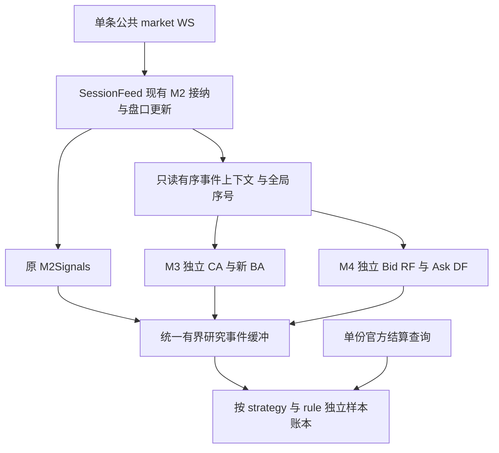

# M3 M4 策略设计与 M2 同源盘口整合方案

日期：2026-11-04，北京时间。状态：设计稿 v1，等待开发；参数为研究初值。

2026-11-05 频率研究更新：用户要求停止并行保留旧M4，仅启用调整后的M4；
M2/M3继续原定义，三类策略只共享盘口，分别统计。新版M4的参数、回放局限及运行说明见
[M4_FREQUENCY_STUDY_20261105.md](M4_FREQUENCY_STUDY_20261105.md)。本文后续M4章节保留为v1历史设计。

2026-11-05 实施更新：用户明确保留 M1 运行，暂不在本账户启用 M234 真实订单。
实际采用原 `m2_study` 服务、公共连接、时钟、账本和官方结算流程，增量加入
`m234_signal.py` 观察器，使用 `--include-m3-m4`；本设计后文的新 runner/新数据库建议不执行。
M2 主规则为 `all_candidates`，四个减弱比例组保留研究比较；M3/M4 分别独立记录。
三类各自每场每边最多一笔，风险至多5 USDC，均沿用锚价假设成交口径。
真实账户执行仍未启用，公共盘口运行不能替代原真实执行的一小时验收。
M1 及其账户、订单、配置和服务不作操作。具体启用与回退见 `M2_CANDIDATE_STUDY.md`。
部署、冻结版本及初次运行证据保存在 `evidence/m234_public_20261105/`。

公共运行进展：修复M4队列重建编号复用及候选自身过期核对后，129项测试通过；
新版于北京时间2026-11-05 01:15–02:17连续运行约62分钟，12个完整市场、零服务重启。
验收场次M2假设成交2笔、M3假设成交6笔，均已按官方结果结算；M4未触发，逻辑覆盖来自离线测试。
详见 `evidence/m234_public_20261105/r2/`。存在被剔除的积压/断流片段，不宣称全程数据有效。
这仅完成公共盘口联调；真实Maker部署及一小时实盘验收仍等待用户指定独立账户或协调方案。

未部署执行模块的离线核对：已修正旧市场撤单后的迟到成交复查，换场不再停止核对已发送订单；
成交归账或风险预留变化后，禁止使用变化前开始的资金读取准入，必须等待更新的官方资金读取。
相关执行回归19项通过，含离线SDK签名/发送边界测试；未调用真实账户或订单接口。
这些修改位于 `m234_execution.py`，不在当前公共观察进程的加载路径中，不改变盘口冻结版本。
该模块尚未完成与原M2服务的真实执行部署，不是可宣称已验收的实盘系统。

目标是在现有 M2 公共行情研究进程中，用同一条实时 market WS、同一份逐 token 盘口及同一组时钟，同时观察 M2、M3、M4。三组分别产生候选、锚价、有效性、假设成交和官方结算结果。首阶段回答“信号出现时，这个锚价对应什么结算结果”；Maker 排队与实际成交条件下的结果属于下一阶段。

价格只用于识别档位、冻结报价、检查 Maker 合法性和研究结果分组。信号触发不使用价格涨跌、推进 tick、外部标的价格、仓位或盈亏。

## 1. 当前运行基线

设计核对时，`polymaker-m2-study.service` 为 active/running，PID 449144。服务使用 `python -B -m polymaker.m2_study --disable-cpu-guards`，CPU 配额无限制，Nice 0，MemoryMax 256MiB。该状态仅代表本次只读快照。

当前版本：`245ac18cc47941cd70950bc8e3a769a9372541b306902dfadb1485a1a27221e6`。当前磁盘源码与运行定义保存的全部源码哈希一致。参数、源码哈希、服务及运行摘要已固定在 [m2_baseline.json](evidence/m234_design_20261104/m2_baseline.json)。

| 项目 | 当前 M2 实际口径 |
| --- | --- |
| 候选过程 | AP_BUY 确认，此后新形成 RF_BID；BUY 减弱不作为候选采集门槛 |
| AP | 750ms；最小1份及事前深度0.01%；BUY份额至少65%；至少2条，受子窗口条件约束；单条集中度至多95% |
| RF | 2个固定500ms轮次；冲击下限 `max(0.5份,0.0001×Q0)`；固定可见 Bid 档位；100ms恢复维持；2轮最终恢复比例中位数至少50% |
| RF时序 | 轮次序列最多15s；确认后寿命8s；AP参照20s；AP确认清除本策略此前RF |
| BUY减弱组 | all_candidates、比例上界≤0.25/0.50/0.75/1.00；每250ms观察，完整窗口须在AP确认之后 |
| 成交流 | 不强制全部成交与触及价相等；启用经互补盘口和身份核对的派生成交视图 |
| 样本时段 | `[T15,T240)`；T240结束输入，T300完成换场；此前可预热组件 |
| 假设账户 | 每规则单笔买入成本至多5 USDC；每规则每场20 USDC；每方向至多1笔假设成交 |
| 成交/结算模型 | 合格观察时按锚价假设足额买到，持有至官方最终结算；不含费用和返佣 |

M2不是11月1日信号工具箱中较严格的原始参数组合。整合时保留当前版本为基准，不将新设计参数反向套进旧数据。旧研究代码中RDP-SM M2/M3执行里程碑，与本文M2/M3策略编号无关。

## 2. 三个策略的研究合同

| 策略 | 过程 | 固定锚价 p0 | 想接到的卖盘 |
| --- | --- | --- | --- |
| M2 受控回流 | AP_BUY → 后续RF_BID，并观察买入速率衰减 | RF承接的可见Bid档位 | 买方进攻减弱后，承接仍有效期间再次到来的卖出 |
| M3 买方接力 | CA反击 → 新的BA守价 | 新BA的买一档位，与仍有效的CA买一锚相同 | 反击后已被再次承接检验的后续卖出 |
| M4 防守分化 | RF_BID持续补给，与DF_ASK卖方恢复转弱同时有效 | RF_BID固定可见档位 | 双侧防守分化仍成立时到来的卖出回流 |

三者可以在同一市场、同一方向、甚至同一事件边界触发。所有触发各自保留；同一次卖出或同一最终胜负不能当作多个独立市场。它们是三个独立假设账户，首版不构造合并实盘资金组合。

### 2.1 M3 反击后的买方接力

**研究假设。** 主动反击之后，又出现一轮独立的被动承接，提供主动与被动买方需求接力的证据；假设后续卖出仍可在该档位被承接。此假设不证明同一参与者先攻后守，也不预先保证结算胜率提高。

**组件参数。** 显式冻结独立研究参数，不读取运行中的交易配置，也不依赖 `RDPBAConfig()` 会变化的默认值：

- CA：先SELL累计至少5份，随后BUY累计至少10份；首次有效SELL起750ms内确认；总寿命为首次SELL的t0+3s。
- 新BA：CA确认后首次合格SELL启动；SELL量、可见累计下降量、随后累计正增量各至少5份；750ms内形成；自身寿命为BA首次SELL的tB0+3s。
- 两个组件分别使用本地盘口年龄200ms、成交源年龄500ms、源时间回退容差20ms，沿用既有检测器的丢弃/失效语义并完整计数。缺口、严重乱序、tick变化、断线和generation变化按既有规则失效。
- 复用生产CA/BA的信号语义。BA当前累计正增量确认，不等于RF的净恢复与100ms维持；在报告中明确二者不同。CA执行入口的确认持续时间、最大开仓年龄、网络预算和claim不是本阶段信号门槛。

**形成过程。**

1. 在单token上得到CA_CONFIRMED，记录其原始t0、确认实际可得时间tC、确认事件全局序号、原买一pCA、固定deadline。
2. 为该CA建立新的M3-BA观察状态。CA前已开始的BA、消耗、回补全部不能用于这个序列。新BA首次SELL必须在CA确认实际可得之后，且全局序号更晚。
3. 在CA仍有效时，原买一档位受到新SELL冲击，随后出现满足BA定义的消耗和补单。CA确认用的BUY不能再当作这轮新SELL。
4. BA确认后，完成本消息BBO核对及盘口发布；在此时两组件仍有效、锚价相同、`0<p0<Ask`、可见量为正、时钟与积压条件合格，产生M3_CANDIDATE及首次有效观察。p0冻结为BA锚价。
5. 候选截止 `min(CA.t0+3s, BA.tB0+3s)`；不能从BA确认重新给CA三秒寿命。每250ms记录后续有效性；不重复产生主样本。

**结束条件。** CA或BA按自身规则失效、原买一改变、锚档位不可见、tick或generation改变、数据不可用、时限到期、T240边界。因数据不足结束，记UNAVAILABLE/CENSORED；不能标为承接失败。CA先失效后才出现BA不能确认本候选。

**同一CA的重叠处理。** token上同一时间只跟踪最新有效CA。新CA会以NEW_CA结束旧候选和其BA分支。首次合格BA确认提供本CA的一次主研究样本；后续观察不重复采样。若已有不合格BA尝试结束而CA仍有效，可启动新BA尝试，保留所有失败/删失记录；第一次满足规则的观察才决定主样本。

**去重。** 根机会为 `(market, strategy=M3, definition_version, ca_id)`；候选ID包含ca_id、ba_id，不能与M2的AP去重键混用。

**首版规则。** 仅 `m3_ca_then_ba_v1`。`CA→RF`、反击后价格推进、额外LW过滤均另列后续研究，首版不混入M3。

### 2.2 M4 双侧防守分化后的承接

**研究假设。** 同一token买方可见队列反复恢复，而卖方在相近冲击下恢复转弱，提供双侧补给能力分化的证据。该过程不要求AP_BUY或CA，避免把M4改成T1的主动追入。

**Bid组件。** 独立计算RF_BID，沿用当前M2的回补参数：2轮各500ms、冲击下限 `max(0.5份,0.0001×Q0)`、相同恢复/维持规则、序列15s、RF寿命8s。M4的RF不因M2出现AP而清空。固定档位只需仍有真实可见Bid数量，允许其不再是买一；这与M2的track_visible_anchor口径一致。首版M4只用直接公开成交，不以另一token的派生视图证明Ask/Bid防守。

**Ask轮次。** 对同一token真正的asks维护方向对称的独立轮次：

- 合格BUY在一个真实可见Ask档位pA上启动，冻结事前量Q0、tA0、500ms截止；只累计同档位BUY为hit。
- `D=Q0-Qlow`；`r=min(1,max(0,Qcurrent-Qlow)/D)`。D=0不可判恢复，不能补成零恢复失败。
- hit与D都至少为 `max(0.5份,0.0001×Q0)` 才是合格冲击。
- 恢复达到50%后开启100ms维持；低于40%清除维持计时，新低重置先前恢复证据；已经建立的维持在恢复低于20%时作废。封口成功为既有held语义成立且r_end≥50%。完全复用M1轮次的数值语义，并对BUY/Ask方向做对称回归。
- 无论是否较早满足维持条件，500ms封口后才确定完整轮次特征。处理实际可得不得晚于截止后50ms，且输入水位须越过截止；过晚则不可用。
- 不重叠轮次，固定档位至少在完整观察期间可见；档位消失、tick变化、断流为删失，不能拿移出档位后的缺失量当零恢复。

每个token/侧首版只追踪一个活动固定队列。Ask参照尚未建立时可由新的合格BUY选择队列；建立参照后，不同队列的BUY只作为流量记录，不计入该参照。固定队列消失或参照到期才重新选择，禁止按事后恢复最差的队列挑选。

**DF_ASK参照与转弱。**

1. 同一pA连续两轮合格稳定成功，最早轮次开始至第二轮封口实际可得不超过5s；两轮r_end中位数r_ref≥70%。否则尚无可比防守基准。
2. 冻结 `h_ref=median(hit/Q0)`、`d_ref=median(D/Q0)`。各轮使用固定500ms的完整量，不将早确认的小窗口与失败的大窗口比较。
3. 此后5s内，接下来两个合格轮次都需与基准可比：`(hit/Q0)/h_ref`、`(D/Q0)/d_ref`各在[0.5,2.0]。
4. 两轮各自完整封口后均满足 `r_end≤30%` 且 `r_end≤0.5×r_ref`，才在第二轮结果实际可得时确认DF_ASK。第一轮转弱仅为FORMING。
5. 下一合格轮次不可比或恢复正常，则结束本DF候选；不能跳过去等一轮有利结果。未达到最低冲击的微小轮次完整记录，既不算成功也不算失败；数据缺口则清空基准。

DF确认后寿命1s；成功参考两轮保留在证据中。后续同档合格轮次稳定成功且r_end≥70%则结束为DEFENSE_RECOVERED；仅没有新冲击不能宣称恢复。一个参照只生成一个DF ID；重新确认需建立新的两轮成功参照。

**M4组合确认。**

- RF_BID与DF_ASK在同一token、同一generation、本消息核对完成的盘口边界上同时有效。
- 两者内部证据都按其定义完整；较早组件自然到期后不能沿用历史确认。p0为当时RF_BID固定锚，需仍在bids、量为正且低于Ask。
- M4实际确认时间为最终组件就绪且完成盘口发布的可得时间，不能回填到第一轮Ask失败时。
- 候选截止 `min(RF_BID.deadline, DF_ASK.confirmed+1s)`。Bid/Ask各自维护锚价和计时，不强制报价移动或两锚距离条件。
- 任一组件到期/失败/替换、锚不可见、数据质量失效即结束；替换产生新的组合候选。主样本根去重使用DF ID，同一DF不会因RF更换而重复记一次机会。

**去重。** 根机会为 `(market, strategy=M4, definition_version, df_ask_id)`；候选另存rf_bid_id、Ask参照及弱轮次ID。首版只设 `m4_rf_bid_and_df_ask_v1`。

**参数边界。** Bid/Ask轮次下限采用当前M2探索配置，DF的70%参照、30%转弱、0.5至2倍冲击可比性为新增研究初值。它们与11月1日工具箱的500/750ms、3/2轮及触及价要求不同，须作为新定义版本，不能称为已经校准。

## 3. 统一信号测试与后续执行测试

### 3.1 S0 同锚价假设成交 为本轮首阶段

所有策略使用当前M2模型 `FULL_FILL_AT_OBSERVATION_PRICE_HOLD_TO_OFFICIAL_SETTLEMENT`：首次有效观察按冻结p0假设足额成交，不等待真实卖单，不证明排队成交。

- M2保留5个既有规则组；M3、M4各一个主规则组，共7个独立假设账户。
- `[T15,T240)`内才可产生假设成交。确认、观察、报价检查都使用当时可得信息；完整时钟下界≥T15、上界<T240，时钟年龄≤60s。观察到的待处理输入年龄≤20ms，否则保留候选特征并标不可模拟成交。
- 每规则单笔成本上限5 USDC，`qty=floor(5/p0,0.01份)`；满足至少5份和市场最小量，不为满足最小量增加预算。p0合法、tick合法、p0<Ask、可见Bid量>0。
- 每规则每场20 USDC，YES/NO各至多1笔ASSUMED_FILL。各规则额度、去重与方向名额独立，额度不能被另一个策略占用。
- 为与M2一致，S0不要求可见量覆盖全部假设数量；保存visible_qty/order_qty并明确足额成交假设。
- 所有主机会都保留，不合格/无额度记录SKIPPED及原因；额度外的研究样本不进入策略PnL与策略胜率。
- 同一规则同一根机会只在首次合格观察时计主样本；M2继续用AP ID，M3用CA ID，M4用DF ID。连续250ms观察不是新交易。
- 新增数据质量问题不倒删已经产生的历史假设成交；后续失效仍完整保存。官方结果未知、冲突或非标准兑付保持待定/异常，不能记负方或零。

S0的比较目标：在同价、同剩余时间和相近输入质量下，信号出现后最终胜方分布是否有差异。每组报告胜率、平均锚价、`Y-p0`、假设成本/PnL、独立市场数及不可用率。`Y-p0>0`不等于相对同价无信号对照已有提升；需要同期同价对照和后续留出验证。

### 3.2 S1 Maker等待 为后续独立研究阶段

候选有效时在p0建立纸面Maker订单，固定有效期不超过候选deadline；记录排队、部分成交、失效撤单与撤单期间迟到成交。只有相应模型判定的成交才计入S1成交条件下结算结果。

价格触及、深度减少或一笔SELL出现，均不能自动证明我们在队列中的订单成交。公开L2只能构造有假设的排队模型；结果标MODELLED_FILL，不能称真实账户成交。自身成交导致的后续回补特征和样本选择需另行规定。

S0与S1分别设置execution_model_version，不能混合PnL或用S0胜率回答Maker实际成交条件下的胜率。本设计首版只实现S0，S1另立验收。

## 4. 一条实时盘口 三套独立状态

### 4.1 行情与分发顺序

保留现有 `feed.m1=M2Signals(...)` 为当前M2的输入接纳与盘口更新路径。增加仅在新共享研究入口显式启用的observer列表，普通SessionFeed调用默认没有该列表。

每个消息提供只读上下文：原始frame/row/change索引、token/generation、源时间、received wall/monotonic、processed/available时间、M2接纳结果与原因、更新前盘口、逐档前后数量及消息结束后经BBO核对的盘口。使用现有不可变TokenBook/tuple引用，避免每档为三个观察器深拷贝完整book。

处理顺序：

1. reader收到公共帧，分配全局input_seq并保存真实接收时间，保留原始数组顺序。
2. 现有M2路径逐消息/逐档判断并应用盘口；不改变它的旧深度过滤、watermark和互补流处理。
3. 在对应更新前/后给M3/M4独立观察钩子。M3只用直接交易所事件；M4同样只用直接成交。派生互补流保留origin_seq、origin_token和derived标记，只用于M2既有路径，不能再当第二笔真实成交分发。
4. M3的CA/BA可在内部形成证据，但新策略的可交易观察须等本消息所有子更新与BBO核对完成后再发布。中间出现确认、消息结束即失效时，只留组件过程，不产生有效S0观察。
5. 三套独立计时器在同一事件循环运行，使用相同monotonic时钟及输入水位。记录定时器实际执行时刻，禁止事后用理想时钟补发过期确认。

每个观察器独立保存其接纳时间水位、去重记录与状态；可以在同源公共事实基础上使用更严格的规则。M2忽略的旧深度不会被M3/M4重新应用到共享盘口。对未应用的事件，只记录其接纳/拒绝与不确定性，不把不存在的post-book变化当证据。共享盘口有缺口时三者都记录受影响区间；某策略自己的状态或输出失败只结束该策略。

### 4.2 两个必须避开的耦合点

**M2重置RF。** `M2Signals.start_campaign()`在每次AP_BUY确认时清除其round/rounds/rf。M3/M4不得引用这个可变state；M4自己的RF不能被这个清除动作影响。组件算法可以复用，状态实例不能共用。

**BA影响共享过滤。** `SessionFeed.ba_detectors()`的source_times参与公共深度的source_floor。若直接把M3 BA塞进feed.ba，可能改变M2看到的深度。M3应通过独立read-only adapter使用BidAbsorption方法，排除在ba_detectors集合之外；adapter提供它需要的feed/clock/book视图，不进入真实下单/claim入口。

CA也用独立adapter及研究记录回调，不直接依赖无writer时只有512条的内存记录。BA的events需及时drain进研究缓冲，不能无限保留。M3/M4都不返回可被既有交易控制器消费的Signal；即使错误调用evaluate也只能返回NONE。

### 4.3 故障、积压和资源

- observer钩子只做有界计算和入队，磁盘写入、官方GET及报告在批量排空路径完成。每秒批量写，报告最多每分钟更新；不在每条盘口更新上扫历史SQLite。
- 保留当前无CPU配额、无CPU门槛的运行选择，不能因整合自行恢复CPU退让。继续记录loop delay、pending input年龄、各策略计算耗时、memory、队列水位与不可用原因。
- 各策略使用独立有界输出队列（初值4096条），writer轮转批量消费；一个策略不能占满另一个队列。溢出立即将本策略标为UNAVAILABLE，预留控制记录位置保存丢失区间；不得静默丢证据后继续记合格观察。
- Ask/Bid活动固定锚每token/侧至多1个；轮次历史按20s和至多64轮双重限制。若容量限制截断当前必要基准，明确结束候选，不能继续把缺失基准当完整。
- 新观察器抛出异常由自身边界捕获，记录strategy failure；共享reader/盘口或writer整体失败则整场标不完整。新观察器的异常不得冒充“无信号”。
- 保留总输出512MiB上限、磁盘空闲2GiB下限和现有256MiB内存预算。达到总存储边界停止研究采集并保留未完成状态，不删除历史文件。新增流量在接入验收中量测，不承诺零性能开销。

## 5. 数据结构与可比性

### 5.1 新研究数据集

新入口建议 `polymaker.m234_study`，独立设置 `m234_config.py`，输出 `research_outputs/m234_virtual/`。现有 `m2_study.output_path()`只允许m2目录，不通过放宽它的范围迁移旧数据。部署时新入口接替M2采集服务的职责，同一时刻只有一个研究进程拥有这条M2/M3/M4公共订阅。

新进程复用M2Study的市场发现、时钟、tick核实、结算、批写逻辑；提取为研究组件时需要回归测试，而非直接复用会修改旧数据库的M2Study构造器。旧M2账本保持归档读取，新runner使用新账本及新锁。M1实盘或其他独立任务不在此共享采样器内。

### 5.2 表与唯一键

| 表 | 关键字段与用途 |
| --- | --- |
| markets | 唯一market slug、condition/token身份、起止窗口、官方胜方、完整性；零候选市场也记录并结算 |
| runs | dataset/collector版本、启动参数、源哈希、开始结束、每策略健康状态；每market仅一次主观察窗口 |
| component_events | strategy/component、component_id、side、anchor、origin_seq、确认可得时间、deadline、失效原因；包含成功、失败和删失轮次 |
| candidates | strategy/rule/根机会ID、组件ID、p0、形成/结束可得时间、deadline、参数版本 |
| observations | candidate、实际可得时间、shared_snapshot_id、input_seq水位、价格/深度、质量与失效标记；M2 ratio字段改为可空而非强迫所有策略提供 |
| samples | strategy/rule/definition_version/root_opportunity_id，首次合格观察、S0价格数量成本、ASSUMED_FILL/SKIPPED及原因；唯一键包含strategy和execution_model |
| limits | 各策略/规则/市场/方向的名额与已占用成本，事务中判断并写入，重启后仍有效 |
| resolutions | 每市场一份官方身份与最终结果证据，由三组共同引用 |

每个组件记录最小证据范围及shared_event_id；新M3记录ca_id/ba_id，M4记录rf_bid_id、Ask参照/弱轮次ID和df_ask_id。Ask的ROUND_CLOSED必须同时写入side与anchor，不沿用当前缺少方向的记录形状。

策略统计只能取本策略额度内ASSUMED_FILL的trade_pnl；额度外sample_pnl单列。不能把M2+M3+M4假设账户相加成一个20 USDC账户，也不能将同场多笔当独立市场。

### 5.3 版本标识

- 保存 `m2_baseline_version` 指向当前运行指纹，另存strategy_definition_version、collector_version和execution_model_version。
- 新runner的源码指纹包含所有新增observer/adapter/store/report；旧fingerprint函数的文件清单不足以覆盖新代码，必须扩展。
- 新runner不冒用旧版本号。即使M2逻辑等价，采集负载、运行入口和数据分布可能改变；先按新旧采集epoch分开，验证后再决定是否可合并。
- 同一个recorded event流、相同时钟/水位下，旧runner与新runner中的M2候选、锚价、ratio、失效和首个样本必须一致。比较时仅标准化随机namespace/ID，通过证据关联映射，不能把时序差异一并抹掉。
- 新M3/M4参数阈值只修改自己的定义版本。任何公共盘口/时钟接纳规则变化都提升collector版本并重新核对M2。

### 5.4 事件保存范围

首版持续保存有序组件、必要逐轮特征、质量水位与候选观察，不强制长期保存全量原始WS帧。shared_event_id证明同源关联，但不能独立重建未保存的全部盘口。

开发验收另外使用受限短时公共行情录制作为重放夹具，保存初始book、原始帧、真实接收时间、时钟/定时器调度、generation和哈希；控制体积、单独标出覆盖范围。生产历史M2只有派生证据，不能回填出过去的M3/M4信号。三者的正式共同对照期从新runner第一次完整市场开始。

## 6. 报告与统计

统一报告按strategy/rule列出：全市场数、完整市场数、可用观察时间、组件/候选/首次有效样本数、额度内假设成交、SKIPPED原因、已结算与待结算、胜率、平均锚价、成本、假设PnL、`Y-p0`和独立信号市场数。

质量报告按策略分开列：公共流缺口、处理过晚、盘口/成交不对齐、乱序丢弃、重复歧义、部分窗口、锚档位消失、候选到期、自己队列溢出。完整市场标记只代表覆盖起止时间，不能代替内部无缺口。

同时给出共同完整市场上的三组比较，以及各组自身覆盖；不能只留下三者都出信号的市场。按p0、剩余时间、方向、相同/不同触发时刻分组。重叠信号保存共同事件ID；YES与NO共享同一市场最终结果，按五分钟市场聚类。同期同价无信号观察若作为基线，必须预先固定采样时点和完整性要求，不能事后挑选。

首版M3/M4各一个主规则，不自动寻优。探索结果与后续冻结规则留出市场分开；样本稀少、观察删失和多次查看都会限制结论。仅输出实际有依据的不确定性范围，不以“达到若干市场”当作效果已被证明。

## 7. 开发顺序与验收

### 7.1 开发工作包

| 顺序 | 交付 | 关键验收 |
| --- | --- | --- |
| A | 有序只读observer钩子、共享runner、新账本和M2兼容适配 | M2在同输入与时钟下等价，单订阅，随机ID规范化后证据一致 |
| B | M3Signals、CA/BA独立适配器 | CA后新BA、严格事件顺序、不复用旧冲击、期限不延长 |
| C | 双侧轮次、Ask参照/DF与M4Signals | 相近冲击、连续弱轮次、固定500ms、删失与失败区分 |
| D | 七规则独立S0账户、共享结算与统一报告 | 根去重、方向限额、重启、官方身份、版本分隔 |
| E | 同源短时影子验收及性能记录 | 新观察器不会改变M2输入；单策略异常隔离；有效率无不明下降 |

建议拟新增 `m3_signal.py`、`m4_signal.py`、`m234_observer.py`、`m234_config.py`、`m234_store.py`、`m234_study.py`、`m234_report.py`及专用测试。已有RDP-SM M3名称不复用。共有算法提取只在等价测试通过后做，避免以继承M2Signals并共享state实现新策略。

### 7.2 必需的行为验收

1. M3：CA前已开始的BA不能形成；CA确认同一条事件不能又作BA首次SELL；CA失效/新CA替换、BA乱序、deadline边界、锚改变及时结束；BA确认但消息最终BBO不一致不能产生合格S0。
2. M3：CA默认512条记录限制、BA事件队列排空与溢出行为有明确边界；长市场不因无writer适配而静默停止观察。
3. M4：Ask稳定成功→两轮相近冲击弱恢复可确认；冲击5倍、不足窗口、零损失、盘口消失、断线不能冒充DF；中间恢复正常不能跳过。
4. M4：新AP只清除M2 RF；M4历史参照保留。不同token、不同anchor、不同generation不能拼成参照或组合。互补派生成交不能另作一次Ask冲击。
5. 同源：买卖一条消息中先减后补按逐档顺序记录；原始/派生事件身份可追踪；M3/M4拒绝不改变M2的post-book或accepted结果；新策略异常不使M2失效。
6. S0：七组额度互不占用；同CA/DF不重复；同场每方向一次；最小量失败不占名额；未知结算不记零；重启不开第二个同场窗口。
7. 性能：分别比较M2-only与全部启用的输入水位延迟、循环延迟、各策略有效观察比例和最大内存。存在延迟导致的信号损失时必须报告，不能通过放宽时效门槛通过验收。

### 7.3 未来部署切换步骤

完成离线与影子验收后，于市场边界结束旧M2研究进程并排空；旧库中该场完整/中断状态如实保留。新runner从下一完整五分钟市场开始，以新数据集、新锁和新版本运行；保留CPU门槛关闭的用户设置。旧M2 watcher调整为读取新统一报告并逐策略判断，不能同时维持第二套M2采集或查询新库不存在的旧字段。回退时结束新runner并保留数据，再从下一市场恢复旧M2；不重放同场制造第二次机会。

这一步属于后续实现部署。本轮只交付策略及整合设计、参数草案和核对证据。

## 8. 设计依据

- [当前M2研究说明](M2_CANDIDATE_STUDY.md)；[M2参数](../../src/polymaker/m2_config.py)、[候选状态](../../src/polymaker/m2_signal.py)、[runner](../../src/polymaker/m2_study.py)、[账本](../../src/polymaker/m2_store.py)。
- [CA原语](../../src/polymaker/rdp_sm_ca.py)、[BA原语](../../src/polymaker/rdp_sm_ba.py)、[M1回补与流量原语](../../src/polymaker/rdp_sm_m1_signal.py)、[公共盘口接入](../../src/polymaker/rdp_sm_marketdata.py)。
- [原始信号研究规格](../research/ORDERBOOK_SIGNAL_TOOLBOX_V1_20261101.md)。本文显式给出的新研究参数优先适用于未来M3/M4，不将旧研究描述当当前运行配置。
- [机器可读参数草案](M234_SHARED_MARKET_STUDY_DESIGN_20261104.parameters.json)；[运行基线证据](evidence/m234_design_20261104/m2_baseline.json)。
