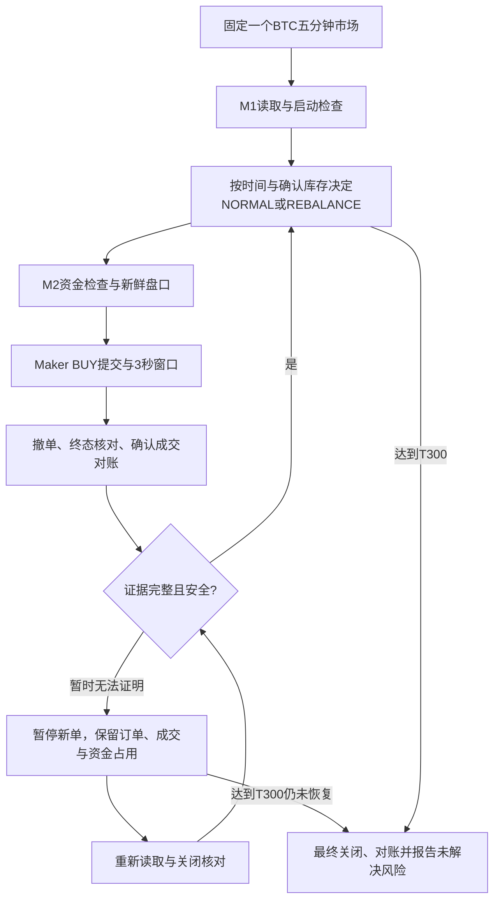

# RDP-SM 业务流程与容错

更新日期：2026-10-13。范围是当前单市场 CLI 的暂停、复核、恢复与退出；
沿用现有 M1/M2/M3、FL Gateway、资金核算、撤单、FillTruth 和 Journal。

## 问题与业务流程

此前主循环把一个窗口首次返回 `BLOCKED` 视为整轮市场结束。收尾时再次
核对可能已经恢复 `SAFE_TO_CONTINUE`，但循环的退出决定没有撤销。
仓位差异和部分成交确认另有等待逻辑，其他正常延迟容易遗留已成交单腿。

实际案例 `7400e42481934996866ade6792379969`：NO 确认成交5股；YES撤单
在20:20:47返回ACK，首次查询仍是LIVE；20:20:50再次核对已是CANCELED，
20:20:51收尾屏障安全，但循环已经退出，留下NO5股。

当前流程：

库存始终取本轮已确认成交减去已验证Merge数量。复核成功后重新计算Delta，
再选交易方向和数量，不重用错误发生前的报价，不推断另一腿没有成交。

## 退出与恢复规则

| 阶段/事件 | 当前处理 | 恢复交易需要的证据 |
| --- | --- | --- |
| T<15 | 留在同一市场等待 | 到达合法交易时间并通过M1 |
| 市场查询暂时返回空列表、暂不可交易，盘口缺失、陈旧或读取失败 | 固定已经选定的slug，重读至恢复或市场结束 | 官方身份、盘口、tick与时间重新有效；冲突的多个市场不放行 |
| M1暂时读失败、资金暂时不足 | 等待、重新执行预检 | M1重新READY；原风险观察保留 |
| 下单前余额/allowance不足、20上限不足 | 暂停，刷新账户、重新经M2检查 | 余额/allowance足够，或验证Merge后资金占用降低 |
| NORMAL任一腿不足1、报价跨盘或非法tick | 跳过本次报价，后续重新读盘口 | 新报价满足原规则 |
| 订单明确拒绝 | 保留其他已接受订单并完成关闭、对账，后续重新决策 | 已知订单的关闭屏障安全 |
| 撤单ACK后订单仍LIVE、累计成交状态延迟 | 暂停新BUY，重复已知ID撤单与终态/成交核对 | 实际终态及完整成交集合验证通过；ACK不作为终态 |
| MATCHED/MINED尚未CONFIRMED | 继续等待确认 | 原M2确认、终态与对账条件全部满足 |
| 新成交或事件使缓存证明失效 | 暂停，重新通过M2关闭与对账 | 新确认库存与新证明完整；旧计划不可提交 |
| Data API仓位差额>0.01股 | 重读Data API等待，保留真实成交 | 两侧差额均≤0.01股；不用链上仓位回退 |
| 读取超时、连接问题、429/5xx | 暂停后重新读取 | 完整的新读取以及相应的账户、盘口、关闭证明 |
| 动态Tick与盘口Tick不一致、Tick暂时不支持或格式无效 | 暂停BUY，重读该市场官方Tick与盘口 | 两份Tick严格相同且受SDK支持；不能用0.01容差替代Tick合法性 |
| 官方时间接口中断 | 暂停BUY，使用已验证官方时间锚与单调时钟限制等待 | 恢复官方时间读取；时间接口持续中断也不会无限等待 |
| UNKNOWN Placement / UNKNOWN Merge | 保留完整未解决资金占用，仅核对/关闭已知订单，等待至T300 | 本实现不自动关联未知订单或重发未知交易 |
| 订单/成交分页不完整 | 保留原有账户风险锁定，等待至T300并报告 | 原有锁定不因后来一个空列表或一次正常读取自动解除 |
| Merge准备失败、缺少Builder凭证或明确失败 | 禁用本轮Merge，保留库存成本，继续满足安全条件的交易 | 不给资金或库存虚假记账；最终报告Merge未完成 |
| 钱包/市场/订单身份冲突、终态与LIVE矛盾、历史风险损坏 | 停止新提交，关闭并报告 | 需要人工解决，不能当作普通网络延迟 |
| Journal写入失败、非法配置、人工取消、未识别程序错误 | 停止并关闭可追踪订单 | 不隐藏错误，不继续无可靠记录的交易 |

已经固定市场后，不自动换市场、重启CLI或恢复历史交易会话。发现市场前
官方时间始终不可用时，最多尝试3次；尚无法证明要运行哪个市场时不交易。

正常时间节奏不变：15≤T<180允许NORMAL和REBALANCE；180≤T<300只允许
REBALANCE；T≥240可验证Merge；T≥300停止新BUY。撤单和对账可能延长。

## 资金与安全边界

- 3秒Fill Window仍从实际HTTP提交开始，恢复等待发生在窗口外。
- M2仍是唯一Maker下单路径。正常缓存证明保持有效时不新增重复关闭核对。
- 只有真实重新核对成功，才能恢复下单。旧窗口的BLOCKED记录不会改写成成功。
- UNKNOWN不清零、不改成拒单或终态、不释放未解决资金、不重复提交。
- 已确认库存不会因接口超时、另一腿拒单或撤单延迟被丢弃。
- Merge成功仍需要原SDK终态、成功回执、双侧精确销毁与抵押资金到账证明。
  准备失败或明确失败不能释放库存成本；未知结果不能恢复交易。
- 故障持久存在，T300以BLOCKED或INCOMPLETE报告。安全关闭的订单屏障与
  无法继续交易的账户/结算状态分别如实记录。

## 实现与观测

`rdp_sm_recovery.py`只识别已有失败原因，不授予交易权限。`rdp_sm_entry.py`
限制启动重试到固定市场；`rdp_sm_loop.py`在原循环内暂停、关闭复核、恢复。
原M2资金、终态与成交对账条件保持不变。

CLI增加`Trading Recovery: PAUSED / RESUMED / MERGE_DISABLED`，显示阶段、
时间和具体原因。库存差异继续显示期望、实际和差额。没有因为日志增加
HTTP请求。JSON和Journal仍使用原数据路径；历史文件不删除、不重写。

2026-10-13的23:10市场曾在T约216因`DYNAMIC_TICK_UNKNOWN_OR_CHANGED`
提前退出，遗漏原因是该读取异常不在恢复名单中。现在启动、M3决策读取和
M2最后下单检查均暂停并复核，异常持续时停单等待T300，然后执行现有
撤单、终态和成交对账。恢复仍绑定原市场，不重发旧报价或绕过Close Barrier。
人类日志显示失败侧、Token ID、官方Tick、盘口Tick及SDK支持值；内容来自
当次被拒绝的读取，没有额外请求或新增Journal事件，JSON摘要保持原格式。

## 离线验证

新增20项生产路径容错案例，覆盖实际NO先成交、YES撤单LIVE延迟后恢复配平，
订单累计状态延迟、API超时、429/503、余额恢复、启动失败重试、永久LIVE、
UNKNOWN不重发、官方时钟中断有界等待、分页风险保留、Merge凭证缺失时继续
REBALANCE以及明确拒单后的继续执行。

旧测试中与“首次阻断就立即退出”相关的运行时长断言按新业务行为更新；
资金预留、禁止超额提交、历史数据保留和不以ACK伪造终态等安全断言保留。

后续将RDP成交价格、数量、订单元数据、累计成交、MATCHED剩余数量、
库存和历史Merge成交价容差统一为≤0.01；原始成交不取整，身份与确认
状态仍严格验证，其他策略默认容差保留。动态Tick恢复新增11项离线用例，
覆盖启动、运行时决策、M2最终检查、持续异常至T300、恢复报价、CLI诊断
及历史兼容。最新完整RDP回归：**635项策略测试通过**；此前共享路径
**173项FL/订单/成交/仓位/结算回归通过**，合计**808项通过，
0项失败**。Ruff及Git空白检查通过。

所有运行均通过离线网络与凭证隔离：**0次网络/DNS尝试**，工作区真实凭证
被禁止读取。真实订单与真实Merge均为0。本次未提交或推送GitHub。
