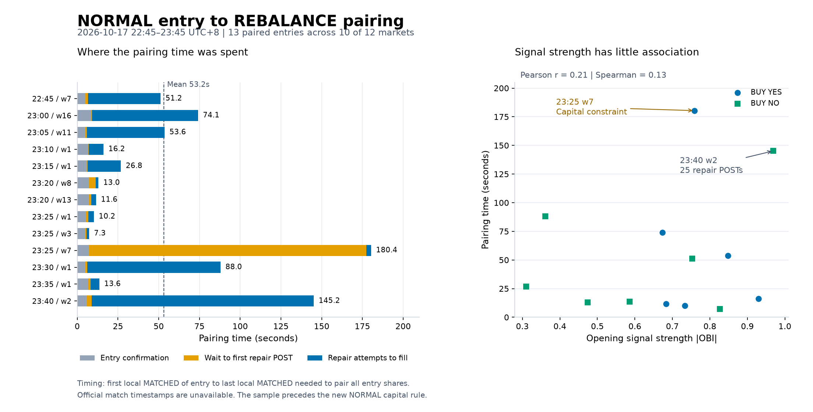

# NORMAL 开仓至 REBALANCE 配对：最近 12 场

范围：2026-10-17 22:45–23:45，北京时间。再次扫描 journal，确认这是当前最新 12 个已记录市场；与上一轮相同，没有新实盘数据。本样本全部早于新的 NORMAL“现有占用＋股数×1.00≤15”准入规则，不能用于验证新规则的实盘效果。

## 结论

- 12 场中 10 场产生 NORMAL 开仓成交。129 次 NORMAL 实发中，13 张订单成交，均为 5 股；13 轮全部由后续 REBALANCE 完成这 5 股配对。2 场无成交不记作零耗时。
- 以开仓首次本地 MATCHED 至另一侧覆盖全部开仓数量的最后本地 MATCHED 为配对耗时：**平均 53.153 秒，中位数 26.810 秒**，最短 7.278 秒、最长 180.373 秒。13 轮均已完成，没有未配平开仓被排除。
- 以开仓全部 CONFIRMED 至配对全部 CONFIRMED：平均 53.099 秒、中位数 26.850 秒；以最终开仓信号事件至配对全部 CONFIRMED：平均 61.587 秒、中位数 34.518 秒。
- 单独去掉已知资金阻断的 23:25 w7，12 轮主口径平均 42.552 秒、中位数 21.480 秒。这里是同一批的描述性敏感性检查，不是“修复后实测”。
- 开仓 OBI 强度 |OBI| 与主口径耗时的 Pearson r=0.210，Spearman=0.132；去掉资金阻断轮次后分别为 0.188、0.063。当前没有明显的单调关系，不能据此用强 OBI 预测快速配对。
- 按市场分组 bootstrap（10 个市场、20000 次、固定种子）得到 Pearson 的近似 95% 百分位区间 [−0.363, +0.693]。样本小、同市场轮次相关，区间很宽；没有因果识别或有效信号阈值优化。

## 时间和配对口径

原始缓存成交 timestamp 全为 0，官方 match_time 未保留。所有时间使用日志中的本地首次 MATCHED / CONFIRMED 观察；不是交易所真实撮合延迟。开仓信号取发单时最终 final_signal 及其 event_mono，不取市场初始信号或后来反转信号。墙钟按本场网络事件的 monotonic 对齐。

一张已成交 NORMAL 单为一轮；按后续相反方向 REBALANCE 的已确认经济成交，按本地观察先后 FIFO 分配，直到覆盖该开仓实际数量。MATCHED/MINED/CONFIRMED 状态流转只计一笔经济成交；部分成交逐笔累计，而非第一笔补仓成交就算配平。

23:05 的第一张补仓单只成交 0.02，后续又成交 5；到覆盖开仓 5 时才判为完成，剩 NO 0.02 作为额外补仓库存保留。此样本其后没有新的成交开仓，故不涉及跨轮次用该余量配对。该 FIFO 归属用于计时与成交买入价比较，细微收益值不等同于平均成本合并账本，更不等同于最终净收益。

## 逐轮配对

|市场 / NORMAL 窗口|开仓方向 / 最终 OBI|开仓首次 MATCHED|完成配对 MATCHED|耗时 秒|补仓实发次数|
|---|---|---|---|---:|---:|
|22:45 / w7|NO / -0.753|22:46:06.768|22:46:57.956|51.188|6|
|23:00 / w16|YES / +0.674|23:01:42.711|23:02:56.838|74.127|13|
|23:05 / w11|YES / +0.848|23:06:08.436|23:07:02.030|53.594|10|
|23:10 / w1|YES / +0.930|23:10:22.966|23:10:39.116|16.150|2|
|23:15 / w1|NO / -0.310|23:15:30.853|23:15:57.663|26.810|4|
|23:20 / w8|NO / -0.474|23:21:09.584|23:21:22.587|13.003|1|
|23:20 / w13|YES / +0.683|23:21:51.593|23:22:03.155|11.561|1|
|23:25 / w1|YES / +0.733|23:25:25.521|23:25:35.727|10.206|1|
|23:25 / w3|NO / -0.826|23:25:44.729|23:25:52.006|7.278|1|
|23:25 / w7|YES / +0.759|23:26:19.608|23:29:19.981|180.373|1|
|23:30 / w1|NO / -0.361|23:30:24.707|23:31:52.669|87.962|13|
|23:35 / w1|NO / -0.586|23:35:27.853|23:35:41.407|13.554|2|
|23:40 / w2|NO / -0.969|23:40:28.017|23:42:53.200|145.184|25|

## 信号强度分组

以下边界仅为预先固定的描述分组，不是从结果挑出的最优交易阈值。

|开仓 OBI 绝对值范围|轮数|平均配对 秒|中位配对 秒|
|---|---:|---:|---:|
|0.3–0.6（不含上界）|4|35.332|20.182|
|0.6–0.8（不含上界）|5|65.491|51.188|
|0.8–1.0（含上界）|4|55.551|34.872|

信号与配对速度没有呈现越强越快的规律：23:10 YES +0.930 用 16.150 秒，23:40 NO −0.969 用 145.184 秒；23:25 NO −0.826 只用 7.278 秒，YES +0.759 却用 180.373 秒，后者有已确认资金约束。

按方向分组，YES 6 轮平均 57.669 秒、NO 7 轮平均 49.283 秒；这是市场路径和资金约束混合后的描述，不能作为方向优劣结论。FIFO 配对买入毛收益与信号强度的 Pearson r=−0.129、Spearman=0.025，也没有稳定关联。此收益不含返佣、费用或残仓结算。

## 等待主要发生在哪里

以主口径平均值作可加分解：

|阶段|全部 13 轮平均 秒|排除资金阻断轮次后 12 轮平均 秒|
|---|---:|---:|
|开仓 MATCHED → 开仓 CONFIRMED|6.164|6.082|
|开仓 CONFIRMED → 首次补仓 POST|14.489|1.512|
|首次补仓 POST → 配对 MATCHED|32.500|34.958|

排除资金约束后，从开仓确认到第一次补仓提交平均仅 1.512 秒，后续补仓尝试到实际配对平均 34.958 秒。23:40 场 25 次实发补仓、耗时 145.184 秒；23:00 与 23:30 各 13 次实发补仓、耗时 74.127 和 87.962 秒。未成交挂单、盘口过期导致的关闭、拒单恢复、再次准备及行情变动共同形成等待，不能都算作缓存刷新耗时。

资金约束轮次在开仓确认后等了 170.221 秒才首次提交补仓；对应完整配对 180.373 秒，是有明确机制证据的异常点。去掉该点仅用于展示敏感性，不剔除其他慢轮次，也不宣称修复后会直接达到 42.552 秒。

13 张产生开仓成交的 NORMAL 单中，11 张最终因新鲜反向信号请求关闭，从 POST 到该关闭请求中位数仅 0.865 秒。它表明这些订单的有效方向很快变化；由于缺少官方撮合时刻，不能据此认定真实开仓发生在反转之后，亦不能证明入场信号具有或不具有预测收益。开仓信号属于瞬时盘口特征，几十秒后的补仓速度还受确认、资金、成交条件和执行状态影响。

## 验证与复算

逐场原始 journal 的哈希与冻结来源索引匹配；独立核对 33 条 CONFIRMED 的 trade/order 身份、数量和价格。13 轮共覆盖 65 股 NORMAL 及 65 股对侧修复量；另保留 0.02 股额外补仓。13 轮补仓提交合计 80，与原日志汇总一致；三阶段时间逐轮相加等于主口径耗时。未改生产代码、配置或进程，未调用交易 API。

[逐轮 CSV](cycles.csv)、[统计及原始文件哈希](evidence.json)、[分析脚本](analyze.py)、[静态图](pairing.png)、[SVG](pairing.svg)、[复算 Notebook](review.ipynb)。

